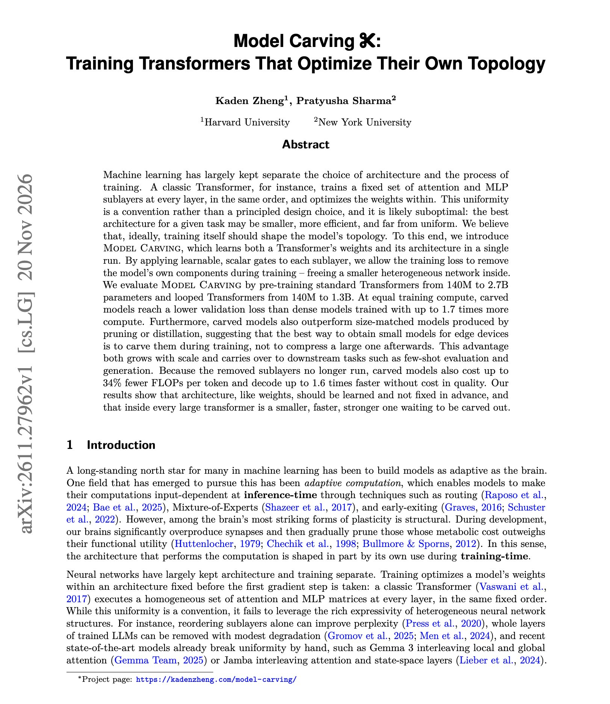

# 🐦 @omarsar0

## 📅 November 24, 2026

> 1 post(s) archived.

---

### 🕐 00:43 UTC · @omarsar0

> // Model Carving // This work from Harvard and NYU proposes Model Carving, which puts a learnable scalar gate on every attention and MLP sublayer. The training loss closes gates it does not need, and those sublayers are removed. At equal training compute, carved models reached lower validation loss than dense models trained with up to 1.7x more compute. They tested standard Transformers from 140M to 2.7B parameters and looped Transformers up to 1.3B. Carved models also beat size-matched models made by pruning or distillation. The advantage grew with scale and held on few-shot evaluation and generation. Removed sublayers do not run, so carved models used up to 34% fewer FLOPs per token and decoded up to 1.6x faster with no quality loss. If you need a small model for edge or latency-bound use, compare carving during pretraining against your current prune-then-distill pipeline. https://arxiv.org/abs/2611.27962 Chat with Paper: https://academy.dair.ai/papers/model-carving-training-transformers-that-optimize-their-own-topology-2611.27962

🔗 [View original post](https://x.com/dair_ai/status/2125027375553605836)

---
