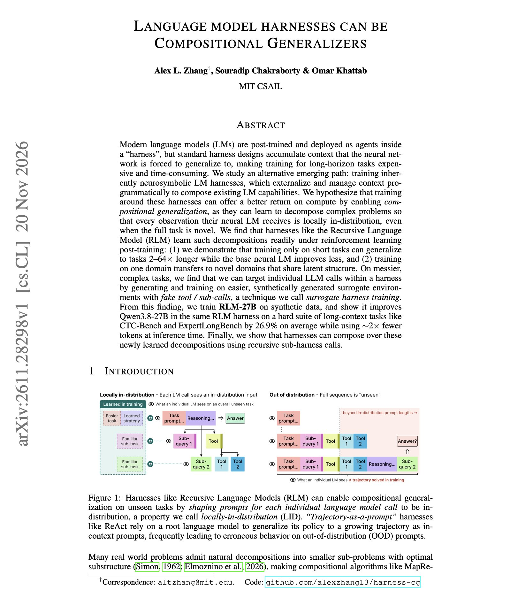

# 🐦 @omarsar0

## 📅 November 24, 2026

> 3 post(s) archived.

---

### 🕐 14:29 UTC · @omarsar0

> Just published my list of top RSI papers of 2026. It&apos;s a really good reading list. (bookmark it) Covers the RSI loop, verification, weaknesses, evals, production systems, and more. https://x.com/i/article/2125233081082613761

🔗 [View original post](https://x.com/omarsar0/status/2125235321097125890)

---

### 🕐 14:12 UTC · @omarsar0

> Banger paper from MIT CSAIL. (bookmark it) It discusses how harnesses can generalize compositionality. In other words, harnesses can push LLMs further (with stronger generalization effects) through existing LLM capabilities. There is a huge debate on whether models will eat harnesses, but this work shows the power of custom harnesses and why they will continue to matter. Standard harnesses keep adding to the context, so the model has to handle inputs unlike anything it trained on. An RLM harness manages context in code and splits a task so each model call sees a familiar input, even when the full task is new. Under RL, RLMs trained only on short tasks generalized to tasks 2 to 64 times longer, and training on one domain transferred to new domains with shared structure. For complex tasks, they train individual calls inside the harness on easier synthetic environments with fake tools and sub-calls. They call this surrogate harness training. RLM-27B, trained this way on synthetic data, improves Qwen3.8-27B in the same harness by 26.9% on average on hard long-context tasks like CTC-Bench and ExpertLongBench, with about 2 times fewer tokens. If long trajectories are expensive to train on, try training the individual calls inside your harness on short synthetic tasks first. https://arxiv.org/abs/2611.28298 Chat with Paper: https://academy.dair.ai/papers/language-model-harnesses-can-be-compositional-generalizers-2611.28298

🔗 [View original post](https://x.com/dair_ai/status/2125230967833190632)

---

### 🕐 00:43 UTC · @omarsar0

> // Model Carving // This work from Harvard and NYU proposes Model Carving, which puts a learnable scalar gate on every attention and MLP sublayer. The training loss closes gates it does not need, and those sublayers are removed. At equal training compute, carved models reached lower validation loss than dense models trained with up to 1.7x more compute. They tested standard Transformers from 140M to 2.7B parameters and looped Transformers up to 1.3B. Carved models also beat size-matched models made by pruning or distillation. The advantage grew with scale and held on few-shot evaluation and generation. Removed sublayers do not run, so carved models used up to 34% fewer FLOPs per token and decoded up to 1.6x faster with no quality loss. If you need a small model for edge or latency-bound use, compare carving during pretraining against your current prune-then-distill pipeline. https://arxiv.org/abs/2611.27962 Chat with Paper: https://academy.dair.ai/papers/model-carving-training-transformers-that-optimize-their-own-topology-2611.27962

🔗 [View original post](https://x.com/dair_ai/status/2125027375553605836)

---
