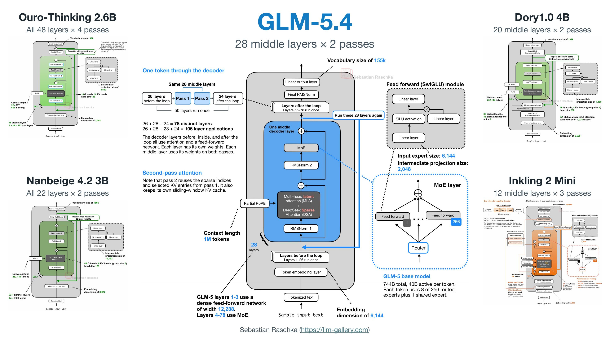
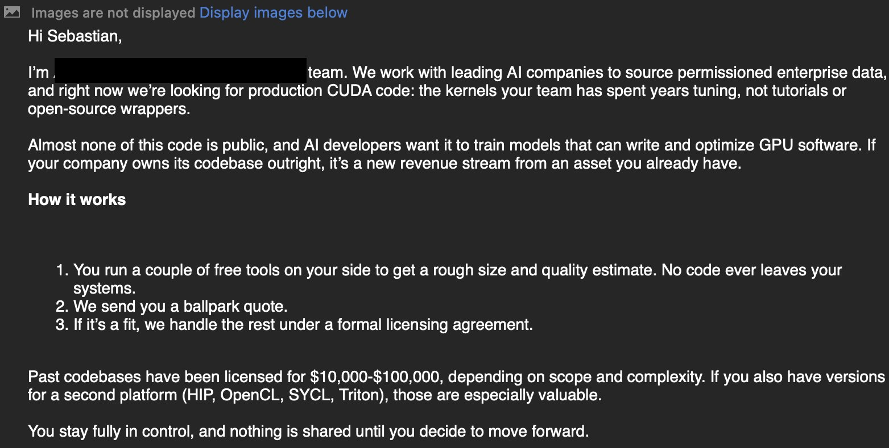

# 🐦 @rasbt

## 📅 November 24, 2026

> 2 post(s) archived.

---

### 🕐 15:27 UTC · @rasbt

> With yesterday’s GLM-5.4 release, there are 5 looped transformers in my LLM Architecture Gallery now. I see a trend :)

🔗 [View original post](https://x.com/rasbt/status/2125249956495953973)

---

### 🕐 15:08 UTC · @rasbt

> Whoever gets their hands on the most battle-tested enterprise code... This is how the ChatGPT vs Claude vs Gemini vs Muse vs Grok race is going to be decided in 2027 and beyond. (And smart enterprises will play multiple fronts.)

🔗 [View original post](https://x.com/rasbt/status/2125245138641490324)

---
