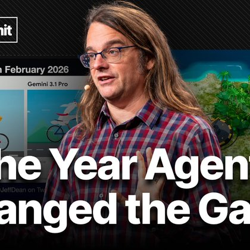
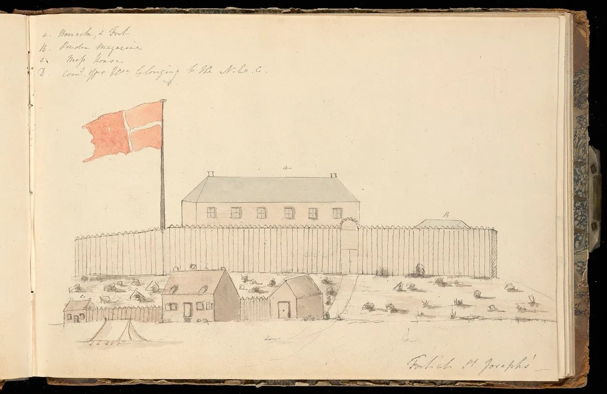
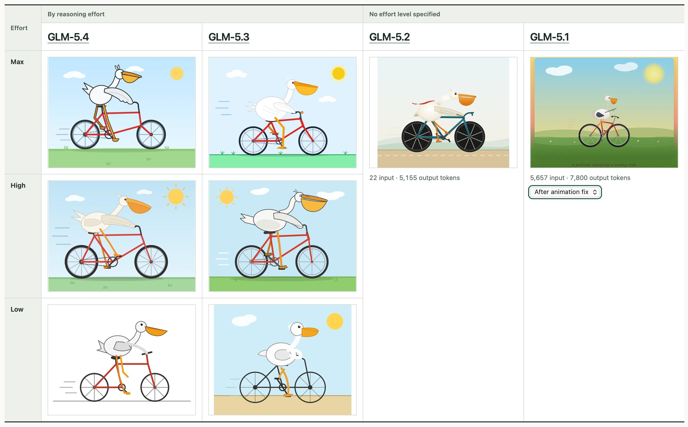

# 🐦 @simonw

## 📅 November 24, 2026

> 4 post(s) archived.

---

### 🕐 23:21 UTC · @simonw

> To accompany the video from my recent talk at @aiDotEngineer, here&apos;s an expanded version of my argument that we&apos;ve seen three key inflection points with LLM over the past twelve months https://simonwillison.net/2026/Nov/24/llm-inflection-points/

🔗 [View original post](https://x.com/simonw/status/2125369126877286662)

---

### 🕐 13:01 UTC · @simonw

> In testing GPT-6.2, I used it to make a significant historical discovery which I detail in the post below. This suggests that the process of research and discovery we’re already seeing in verifiable domains like math is starting to generalize to non-deterministic fields like history. You can read the full post here: https://generativehistory.substack.com/p/gpt-62-astra-solves-a-historical In a nutshell, Yale’s Beinecke Library holds an anonymous sketchbook of an 1808 journey from Montreal to Lake Superior and back. I’ve spent many hours over the years trying to figure out who made the sketches with no luck. The artist could literally be any one of several thousand people. There are few clues: only four dated and labelled images. With minimal prompting, in just 22 minutes, Astra used publicly available sources to identify a minor French aristocrat, the vicomte de Chabot, as the artist and suggested that we test the hypothesis by ordering copies of a little known microfilmed diary of Chabot’s trip it also found. I was truly stunned. I’d never heard of Chabot or this diary! New document finds are also exceedingly rare in a well worn field like fur trade history. I ordered scans of the journal from microfilm and when they arrived the handwriting matched the captions in the sketchbook. The itinerary also aligned perfectly with the few dated drawings in the book. But there was actually the type of conclusive evidence we rarely get as historians: on 18 June 1808, after Chabot’s canoe reached Fort St. Joseph, he wrote “I took a sketch” before describing the exact view of the fort depicted in a matching drawing. The journal itself is also a major find. It had been mentioned once in a dissertation footnote, but in a completely different area of history and is unknown to fur trade or Canadian historians. It’s long and detailed, covering some 162 notebook pages which makes this a significant new document to my field. Attached to the journal was another trove of documents too: excerpts from long-destroyed North West Company papers, journals, and letters. Again, this almost never happens. Both finds equally surprised the other leading experts I consulted. Although we can construct a coherent narrative in hindsight, I cannot emphasize enough how exceedingly difficult this sort of thinking and recall is for humans. Unlike a human, Astra was able to tackle the problem from both ends at once: working forward from the scant facts of the 1808 journey pictured in the sketchbook and backwards from the immense number of surviving facts about 1808 British North America in general. While we can technically explain Astra’s path to this find as a product of enhanced search capabilities, it conducted the investigation from end to end. I basically acted as the research assistant, restricting copies of the paper documents it needed. To my mind, this puts historians in a similar position as the mathematicians found themselves about eleven months ago, when LLMs started to solve the first Erdős problems. Over the past year, we’ve watched these same models go from learning to read handwriting, to beginning to think historically, to mastering the undergraduate essay, and finally to making small but real contributions to human knowledge more or less autonomously. The trajectory seems clear.

🔗 [View original post](https://x.com/HistoryGPT/status/2125213218045858149)

---

### 🕐 05:32 UTC · @simonw

> datasette-charts just grew an integration with Datasette Agent - there&apos;s a live demo on https://agent.datasette.io/ (sign in with GitHub required), or you can watch this demo video instead: Media

🔗 [View original post](https://x.com/simonw/status/2125100206169677915)

---

### 🕐 00:04 UTC · @simonw

> GLM-5.4 is out, and in running pelicans riding bicycles for 5.4 v.s. 5.3, 5.2, and 5.1 I spotted quite a stark style change between 5.2 and 5.3 https://simonwillison.net/2026/Nov/23/glm-54/

🔗 [View original post](https://x.com/simonw/status/2125017693917155424)

---
