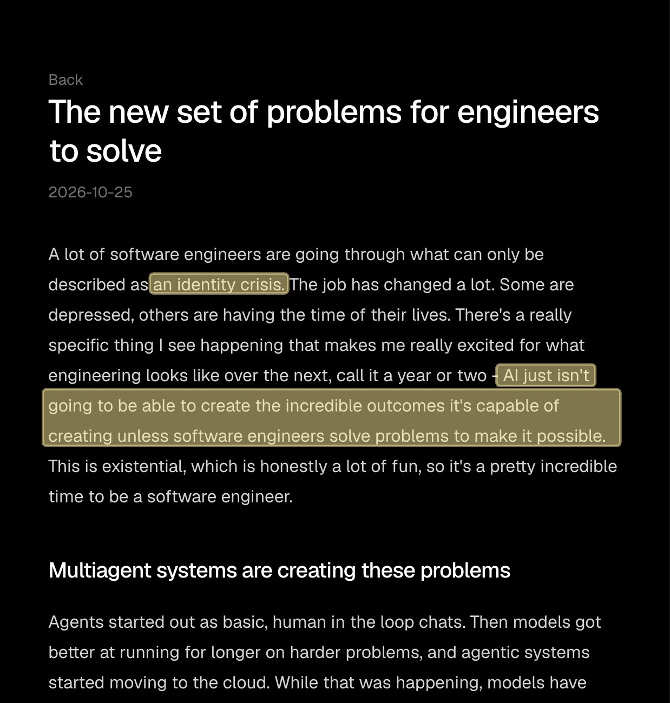
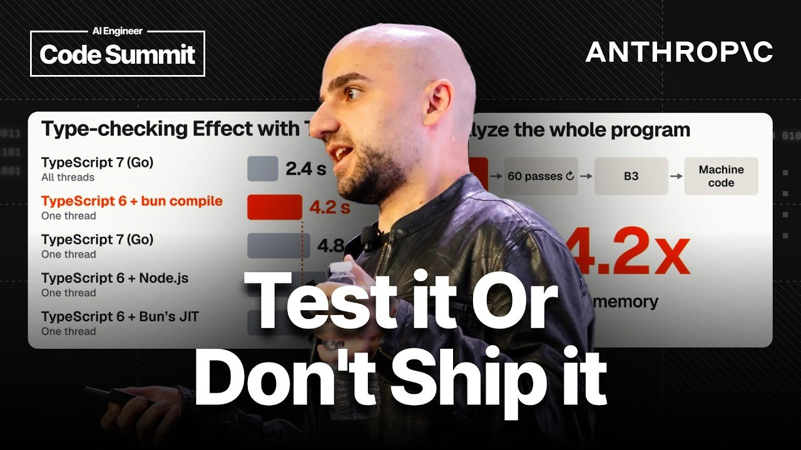

# 🐦 @swyx

## 📅 November 24, 2026

> 7 post(s) archived.

---

### 🕐 23:29 UTC · @swyx

> notable that a lot of the recent anthropic (and ant-alum) talks have been very specific about how much there is still left to do for human engineers, and if you are feeling depressed/anxious you need only look here / point your efforts towards AGI-aligned problems*: - assume multiagent systems 1000x, from spawning subagents to being llm grader to advisor/sidekick pattern to dreaming/memory formation to collaborating peer to peer on a board. what breaks? - Infra: unbundle Kubernetes to new filesystems, sandboxing, stateful, fast workflow orchestration (see @temporalio) at crazy scale. it&apos;s actors on steroids. - Agent Authorization: EVERYONE agrees that having Instinct/Claude etc saving your password is bad (aka taking action On-Behalf-Of you instead of you delegating to an agent&apos;s own identity). (see @KeycardAI @okta etc) Then: how do agents trust another agent? - Security (hardening/patching core software), and Isolation (assuming compromise, limit blast radius) - Monitoring (write-only OTel tracing across agents, linked to kill switches that dont fire false positives confusing agent persistence for malice) actually an incomplete list! you can work at the harness level (https://ai.engineer/talks/vlfCjWuv4es-rethinking-claude-code-best-practices) or solve Fermat&apos;s last theorem (https://youtu.be/wrfbI5eyLAI) but who&apos;s counting anymore *all of which katelyn happens to be hiring for haha software engineers are going to have to tackle a new set of problems to unlock powerful multiagent systems to solve the world&apos;s hardest problems - right now is one of the most interesting moments in history to be an engineer. https://x.com/i/article/2114537761030230016

🔗 [View original post](https://x.com/swyx/status/2125371136943022423)

---

### 🕐 20:30 UTC · @swyx

> Millions of lines. Five rewrites. 140 agents. @jarredsumner of @AnthropicAI on building @bunjavascript&apos;s compiler, and why tests that predate the project matter. Full Code Summit talk: https://youtu.be/TvsF67C2F54

🔗 [View original post](https://x.com/aiDotEngineer/status/2125326086900764900)

---

### 🕐 18:31 UTC · @swyx

> This was a fundamentally foundational talk. Skills changed the game for devs using coding agents. I can&apos;t tell you how many times someone would ask for an agent, but a skill would solve it, and be more portable across projects (depending on the skill). Happy Opus 4.5 release anniversary. This time last year I was attending @aiDotEngineer code summit in NYC and learning about skills for the first time. What a wild year. Wonder what 2027 holds any tin hat theories? I think we will get LLM first programming languages.

🔗 [View original post](https://x.com/onpardev/status/2125296268075553151)

---

### 🕐 18:01 UTC · @swyx

> https://x.com/i/article/2125288675990999040

🔗 [View original post](https://x.com/nicholasachow/status/2125288682903273568)

---

### 🕐 16:05 UTC · @swyx

> US open-weight models have caught up. We post-trained four US models from @meta, @nvidia, @reflection_ai and @thinkymachines with the Harvey Tenet recipe we used on Kimi K3. They are now competitive with non-US models, and Muse Spark Open is the first model to pass 30% all-pass on Legal Agent Bench. https://x.com/i/article/2125019823180554240

🔗 [View original post](https://x.com/harvey/status/2125259420259250209)

---

### 🕐 03:33 UTC · @swyx

> the year is not over. anthropic is still clearly working on P != NP Millennium Prize Problems: humans and two labs tied with a score of one ➤ Human: Grigori Perelman proved the Poincaré conjecture in 2003, the only solution officially recognized so far. He turned down the prize ➤ OpenAI: claimed a solution to the Navier-Stokes problem in Septemb…

🔗 [View original post](https://x.com/swyx/status/2125070165306167497)

---

### 🕐 01:00 UTC · @swyx

> Give Claude the docs. Let it build the wiki. @RLanceMartin of @AnthropicAI shows how Claude organizes company knowledge between tasks. In this experiment, wiki + search beat search alone. From AI Engineer Code Summit. Media

🔗 [View original post](https://x.com/aiDotEngineer/status/2125031651495264340)

---
