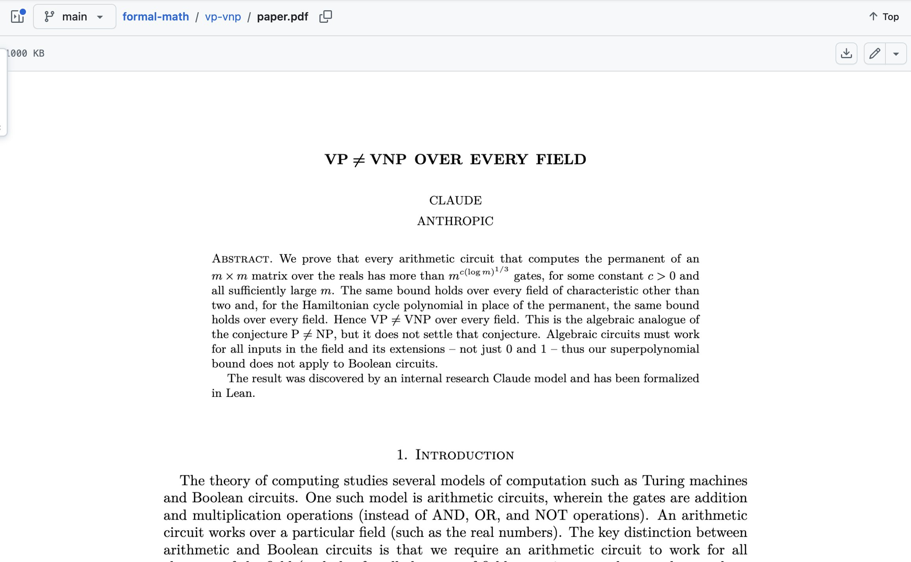

# 🐦 @swyx

## 📅 November 24, 2026

> 1 post(s) archived.

---

### 🕐 03:33 UTC · @swyx

> the year is not over. anthropic is still clearly working on P != NP Millennium Prize Problems: humans and two labs tied with a score of one ➤ Human: Grigori Perelman proved the Poincaré conjecture in 2003, the only solution officially recognized so far. He turned down the prize ➤ OpenAI: claimed a solution to the Navier-Stokes problem in Septemb…

🔗 [View original post](https://x.com/swyx/status/2125070165306167497)

---
