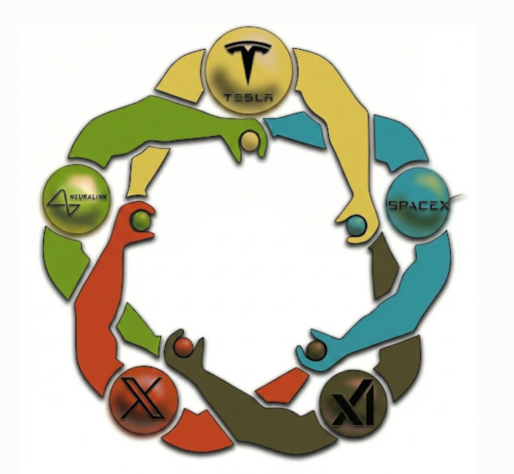
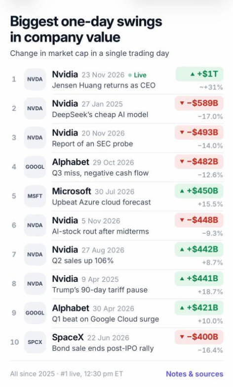

# 🐦 @tunguz

## 📅 November 24, 2026

> 21 post(s) archived.

---

### 🕐 20:47 UTC · @tunguz

> Local AI is privacy. Local AI is privacy.

🔗 [View original post](https://x.com/tunguz/status/2125330414202151328)

---

### 🕐 19:51 UTC · @tunguz

> Men would sacrifice everything in order to win the AI race, even going to therapy. JUST IN: Jensen Huang reveals he&apos;s undergoing 90 minutes of therapy every day following his ouster &amp; reinstatement, saying it has been helping him “a lot.”

🔗 [View original post](https://x.com/tunguz/status/2125316363048669230)

---

### 🕐 19:09 UTC · @tunguz

> Are you being greedy when others are fearful?

🔗 [View original post](https://x.com/tunguz/status/2125305946909954052)

---

### 🕐 18:47 UTC · @tunguz

> I hope they use XGBoost, otherwise they are ngmi. JUST IN: Three founding members of xAI launch Epochal, aiming to build AI that can predict future events with “superhuman accuracy.”

🔗 [View original post](https://x.com/tunguz/status/2125300195437007044)

---

### 🕐 18:34 UTC · @tunguz

> This is huge! Today we’re releasing *SciNet: The Anatomy of Science*, an open database that maps every scientific discipline down to its research tasks. It describes what scientists spend their time on and helps us understand where AI has potential to accelerate discovery. 🧵

🔗 [View original post](https://x.com/tunguz/status/2125297013684126077)

---

### 🕐 18:15 UTC · @tunguz

> This is great news. Just this week I accidentally ended up in chat part getting frustrated with the fact that it could not see my computer. Hi. We’re beginning to roll out the combined Chat and Work experience to a small group of Pro users to learn from feedback before we roll out more broadly. Let us know what you think and where we can improve!

🔗 [View original post](https://x.com/tunguz/status/2125292144462381317)

---

### 🕐 14:59 UTC · @tunguz

> The five directors rn: FT Exclusive: SpaceX and Tesla have entrusted five directors with the fate of the largest merger of all time, with the quintet hashing out the terms of a potential $3.5tn combination and racing to complete the deal before the end of the year. https://ft.trib.al/qrgpsOo

🔗 [View original post](https://x.com/tunguz/status/2125242916990013584)

---

### 🕐 14:35 UTC · @tunguz

> They are so early. Anthropic just fell below its IPO price.

🔗 [View original post](https://x.com/tunguz/status/2125236967575343491)

---

### 🕐 14:32 UTC · @tunguz

> Most people in the US *still* don&apos;t realize how profoundly ALL of the economy is now downstream from AI.

🔗 [View original post](https://x.com/tunguz/status/2125236134196208095)

---

### 🕐 14:27 UTC · @tunguz

> A message to all of my dear former Nvidia colleagues: Huang in there.

🔗 [View original post](https://x.com/tunguz/status/2125234864425517404)

---

### 🕐 14:09 UTC · @tunguz

> Being an Nvidia investor is not for the faint of heart.

🔗 [View original post](https://x.com/tunguz/status/2125230295255265631)

---

### 🕐 13:43 UTC · @tunguz

> Croatia FTW! I&apos;m trying to bring these family values to the States. Average age people leave their parental home in the EU, 2025: 🇭🇷31.5 🇬🇷30.9 🇸🇰30.9 🇪🇸30.2 🇮🇹30.2 🇵🇹28.8 🇸🇮28.8 🇧🇬27.9 🇲🇹27.5 🇷🇴27.4 🇭🇺27.3 🇨🇾27.0 🇮🇪26.9 🇵🇱26.8 🇱🇺26.6 🇪🇺26.3 🇧🇪26.2 🇨🇿25.8 🇱🇻25.7 🇦🇹25.2 🇩🇪24.1 🇫🇷23.8 🇳🇱23.4 🇸🇪23.1 …

🔗 [View original post](https://x.com/tunguz/status/2125223667797721563)

---

### 🕐 13:32 UTC · @tunguz

> More mlx-learn feature improvements. Today we are adding a much faster LinearRegression - up to 18X improvement over the sklearn version on Apple Silicon. mlx-learn 0.1.7 is out on PyPI! LinearRegression now fits up to 18× faster than scikit-learn on Apple silicon: 24.1 ms vs 433 ms at 256,000 rows × 128 features on an M4 Max. Plus exact radius-neighbor search. 🧵 1/7

🔗 [View original post](https://x.com/tunguz/status/2125221136065815037)

---

### 🕐 12:02 UTC · @tunguz

> Yeah, all those headwinds suck, and are going to mess things up in substantive ways for all of us in the coming couple of years. But in terms of AI development it will be just an extremely minor inconvenience. I mean, the current trajectory is already hyperexponential, so the worst case scenario is we still get an exponential growth.

🔗 [View original post](https://x.com/tunguz/status/2125198283265998995)

---

### 🕐 11:36 UTC · @tunguz

> My hot take: we already have enough raw infrastructure to withstand all of the most adverse structural headwinds. AI models are now powerful enough to optimize the living daylights out of the current compute. I should know, I’ve been doing it on a string budget for months. That, in turn, will lead to even more powerful AI. All of which assumes we don’t get *any* major algorithmic breakthroughs for better AI models themselves, which is extremely implausible. In other words, there is no putting this genie back in the bottle. What matters is not Mr. Huang’s libido; what matters is that the technological revolution of artificial intelligence is running into powerful, structural headwinds: rising short- and long-term interest rates, a major political backlash, and an intensification of Cold War II.

🔗 [View original post](https://x.com/tunguz/status/2125191912768327904)

---

### 🕐 10:33 UTC · @tunguz

> Two ants … more ants …🐜🐜🐜🐜🐜 BREAKING: Jensen Huang admitted to having more affairs than previously revealed during a Sunday meeting with Nvidia&apos;s board. — WSJ

🔗 [View original post](https://x.com/tunguz/status/2125175890048876864)

---

### 🕐 10:15 UTC · @tunguz

> They should, and I know exactly the person to play him. Will they make a movie about the Jensen Huang drama like they did with Sam Altman? If so, what should it be called?

🔗 [View original post](https://x.com/tunguz/status/2125171502542672300)

---

### 🕐 01:37 UTC · @tunguz

> I&apos;ve been saying it for years, and I keep getting validated: If you *really* want to know how Silicon Valley works, don&apos;t watch &quot;Silicon Valley&quot;, watch &quot;Game of Thrones.&quot;

🔗 [View original post](https://x.com/tunguz/status/2125041188826644972)

---

### 🕐 01:28 UTC · @tunguz

> 🤣🤣🤣 Nvidia so dedicated to circular accounting, they had to fire Jensen just so they could rehire him

🔗 [View original post](https://x.com/tunguz/status/2125038904961380733)

---

### 🕐 00:43 UTC · @tunguz

> If your company doesn&apos;t fire and rehire the CEO in November, it&apos;s not a *real* AI company. I don&apos;t make the rules.

🔗 [View original post](https://x.com/tunguz/status/2125027425545588845)

---

### 🕐 00:03 UTC · @tunguz

> This is a very good and welcome upgrade! Antigravity now has checklists so you have visibility into long running tasks! This is very useful for your hardest tasks when you don’t want to have side chats. This was one of the biggest issues with the experience and most requested features. Keep shipping with Neon!

🔗 [View original post](https://x.com/tunguz/status/2125017464803090549)

---
