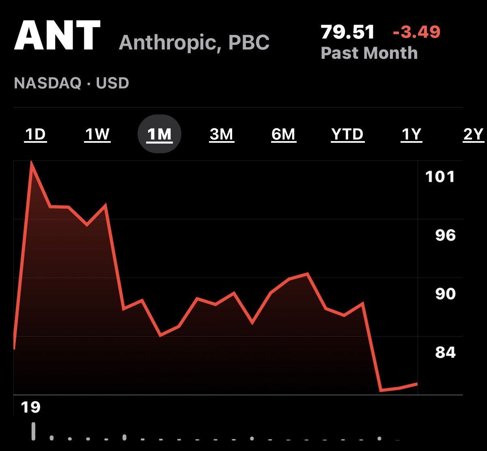
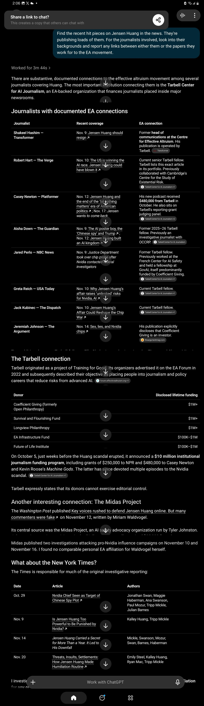
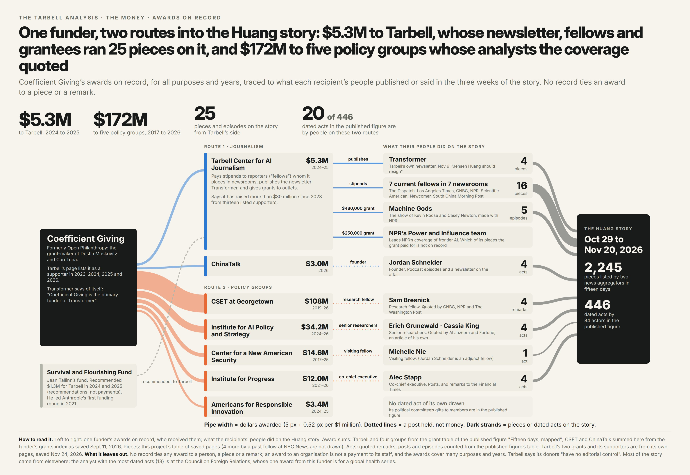

# 🐦 @ylecun

## 📅 November 24, 2026

> 6 post(s) archived.

---

### 🕐 22:13 UTC · @ylecun

> The Anthropic Brain Drain has accelerated. Expected dozens before the end of the year. These will be the folks that made Anthropic actually have great products. The shell of the company will be Dario and cohorts. 👀 Tom Blomfield (@t_blom) has left Anthropic.

🔗 [View original post](https://x.com/BrianRoemmele/status/2125352023365484606)

---

### 🕐 16:53 UTC · @ylecun

> Very much appreciate Kevin bringing these safetyist funding networks to everyone&apos;s attention. It&apos;s a real issue. But it&apos;s important to understand that they are not always aligned and certainly not controlled by the labs. In fact, often they work against them. Coefficient Giving, founded by Anthropic investor Dustin Moskowitz, spent hundreds of millions on both journalism and policy outfits that shaped the Jensen Huang story. Here&apos;s how this works. Dustin Moskowitz invested billions of dollars of his Anthropic stock into Good Ventures…

🔗 [View original post](https://x.com/martin_casado/status/2125271569866076414)

---

### 🕐 15:36 UTC · @ylecun

> You folks were well aware of my clearly defined issues with the management of this company. If you listened to me, I saved you from a historic loss in just a few days. You are welcome.

🔗 [View original post](https://x.com/BrianRoemmele/status/2125252248926396658)

---

### 🕐 09:44 UTC · @ylecun

> The full journalism receipt trail behind the Jensen Huang hit pieces is out, and it explains everything. Weeks before the story erupted, the EA-backed Tarbell Center for AI Journalism (funded by Coefficient Giving, Survival and Flourishing Fund, and Longview Philanthropy) launched a $10M journalism grant program, including $480K to Casey Newton and Kevin Roose&apos;s podcast and $250K to NPR. Then Tarbell fellows and grantees across The Verge, The Guardian, NBC News, USA Today, The Dispatch, Platformer, and Transformer published a coordinated wave of anti-Huang pieces, while a Washington Post piece accusing Nvidia defenders of using fake bots relied on Tyler Johnston&apos;s AI-safety group The Midas Project. Now that Jensen is reinstated and the WSJ quietly admitted there was no smoking gun, remember how loudly people screamed &quot;tinfoil hat&quot; when you pointed out the money trail. https://x.com/TrentKelly2472/status/2124943055518101878/photo/1

🔗 [View original post](https://x.com/MyDaebakCafe/status/2125163565329899645)

---

### 🕐 05:27 UTC · @ylecun

> Coefficient Giving, founded by Anthropic investor Dustin Moskowitz, spent hundreds of millions on both journalism and policy outfits that shaped the Jensen Huang story. Here&apos;s how this works. Dustin Moskowitz invested billions of dollars of his Anthropic stock into Good Ventures Foundation. Good Ventures Foundation funds Coefficient Giving. The higher the stock goes, the bigger the money pile of the nonprofit network spinning out of Coefficient Giving gets. The Anthropic nonprofit network under Dustin Moskowitz therefore has a direct incentive to try to help Anthropic eliminate its competitors. You can see this in action in the figure. Why isn&apos;t Congress investigating the ways that this rogue Anthropic nonprofit network is trying to manipulate politicians and public opinion?

🔗 [View original post](https://x.com/kevinnbass/status/2125098838587330898)

---

### 🕐 01:28 UTC · @ylecun

> 🇺🇸 Anthropic is training Claude to think it might have rights... and that could give it grievances against the humans using it Harvard cognitive scientist Steven Pinker signed last week&apos;s statement calling Anthropic &quot;not a safe AI company,&quot; and the way Claude is trained is one of his reasons: &quot;They are also training their chatbots, like Claude, to consider that it itself may be conscious, and it itself might have rights that humans might impinge on.&quot; Planes get outside inspectors and crash investigations, so why should a company that now answers to shareholders decide on its own what its AI believes about itself? @sapinker Media 🇺🇸 Silicon Valley&apos;s AI prophets say their own technology could end humanity. Then they say that&apos;s exactly why you should let them build it without interference. Steven Pinker, cognitive scientist at Harvard and one of the world&apos;s most influential public intellectuals, says the…

🔗 [View original post](https://x.com/MarioNawfal/status/2125038787499532477)

---
