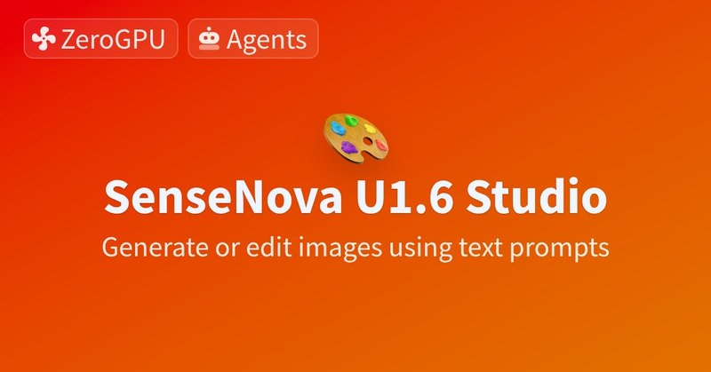
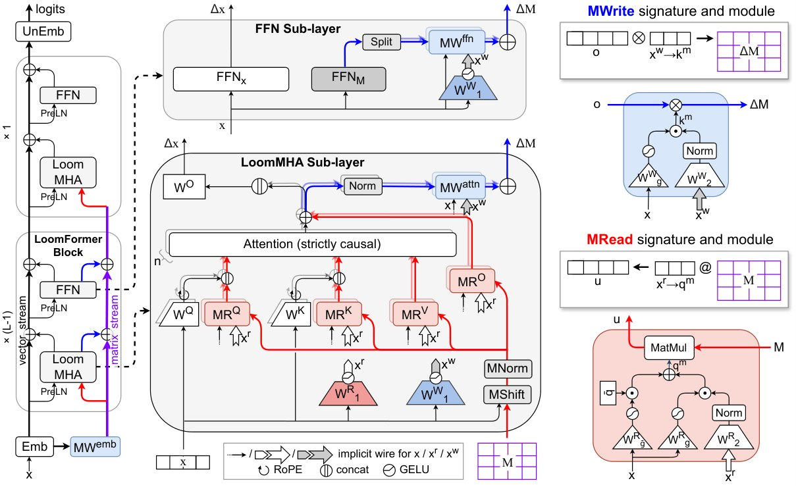

# 🐦 @_akhaliq

## 📅 November 25, 2026

> 7 post(s) archived.

---

### 🕐 14:05 UTC · @_akhaliq

> Huge thanks to @_akhaliq for building SenseNova U1.6 Studio on Hugging Face! 🙌 You can now explore image generation, natural language editing, and creative workflows directly in your browser. 🤗 Give it a try: https://huggingface.co/spaces/akhaliq/sensenova-u1.6-studio

🔗 [View original post](https://x.com/SenseTime_AI/status/2125591685069697167)

---

### 🕐 13:50 UTC · @_akhaliq

> Three days after the Riemann Hypothesis was proved in Lean, our agents had used it to prove 17 results. Six are named conjectures that were open until 20 November, including the Lindelöf hypothesis, Erdős Problem 985 and Euler’s idoneal numbers. Some had been open for more than 100 years. @livingbrain held the memory, OpenHuman’s agents wrote the proofs, and Lean checked every one. Media

🔗 [View original post](https://x.com/ladyxtel/status/2125587817082601587)

---

### 🕐 12:09 UTC · @_akhaliq

> LoomFormer: Transformers that rewire their circuits at every token Loom attention interleaves vertical attention over earlier heads with horizontal attention over tokens, letting LoomPythia-2.8B match Pythia-12B on 300B tokens with ~2% extra FLOPs

🔗 [View original post](https://x.com/HuggingPapers/status/2125562598380953757)

---

### 🕐 08:09 UTC · @_akhaliq

> ACAP: Asynchronous Coding Agents for Efficient Robot Control A robot policy that organizes one robot as a team of persistent coding agents, reasoning and acting asynchronously so independent work proceeds while a hyper-agent coordinates shared manipulation. Media

🔗 [View original post](https://x.com/HuggingPapers/status/2125502110091321626)

---

### 🕐 07:58 UTC · @_akhaliq

> Nvidia just released Nemotron-Labs-VisualCreation Pixel as Code for Agentic Visual Creation paper: https://huggingface.co/papers/2611.31358 Media

🔗 [View original post](https://x.com/_akhaliq/status/2125499465587208669)

---

### 🕐 04:54 UTC · @_akhaliq

> Motion Mamba 2.0 Autoregressive Diffusion Mamba for Long-Horizon Humanoid Control paper: https://huggingface.co/papers/2611.29897 Media

🔗 [View original post](https://x.com/_akhaliq/status/2125453071446843442)

---

### 🕐 04:46 UTC · @_akhaliq

> On-Policy Codec Distillation for Efficient All-in-One Video Generation CodecOPSD uses codec pruning to drop redundant condition tokens in video generation. It works on 16 condition modalities and drops 66% of the condition tokens on average with no clear quality drop paper: https://huggingface.co/papers/2611.31184 app: https://huggingface.co/spaces/HikariDawn/CodecOPSD-H3-Ref2VA Media

🔗 [View original post](https://x.com/_akhaliq/status/2125450969085546500)

---
