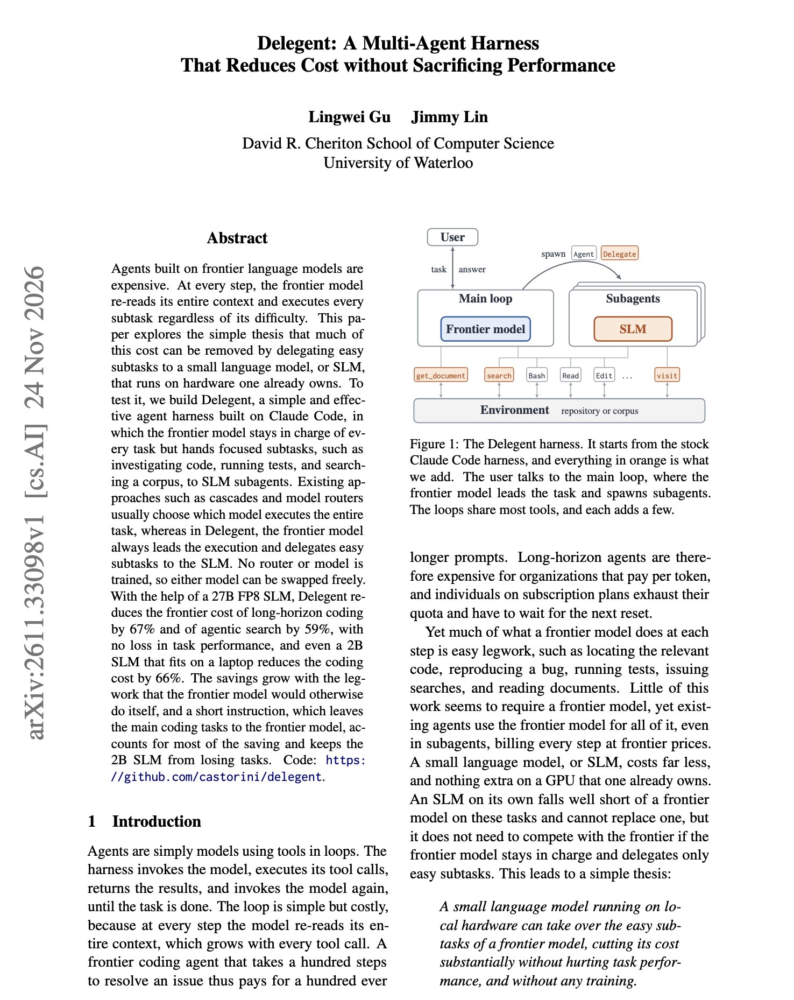
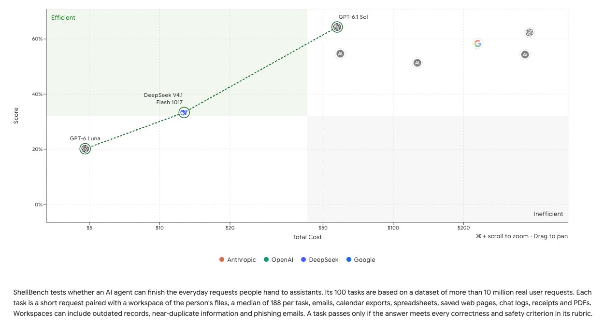

# 🐦 @dair_ai

## 📅 November 25, 2026

> 3 post(s) archived.

---

### 🕐 14:26 UTC · @dair_ai

> Great practical paper from the University of Waterloo on agent costs. To lower agent costs, you want the frontier model to lead every task, with a small local model handling routine subtasks. (bookmark it) Delegent is built on Claude Code. The frontier model plans and makes the main coding changes. It hands code reading, test runs, and corpus search to subagents running a small language model on your own hardware. With a 27B FP8 model, frontier cost fell 67% on long-horizon coding and 59% on agentic search, with no loss in task performance. A 2B model that fits on a laptop still cut coding cost by 66%. No router or model was trained. One short instruction, which keeps the main coding tasks with the frontier model, accounts for most of the savings. At API prices, the 27B model adds 3 to 10 cents per coding task. If your agent bill is high, check how much of the frontier model&apos;s spend goes to reading files and running tests, and move that work to a local model. Paper: https://arxiv.org/abs/2611.33098 Chat with Paper: https://academy.dair.ai/papers/delegent-a-multi-agent-harness-that-reduces-cost-without-sacrificing-performance-2611.33098

🔗 [View original post](https://x.com/dair_ai/status/2125596877966213596)

---

### 🕐 03:47 UTC · @dair_ai

> This new benchmark, ShellBench, offers a solid set of tasks for testing your agents and harnesses on real-world everyday tasks. 100 day-to-day tasks based on real user requests, graded on correctness and safety. IMO, it has a good set of tasks that you would want to test personal agents on. Great work from the cracked teams at @parsewaveai, @openclaw, and @kaggle. We partnered with @openclaw and @Parsewaveai to reproduce ShellBench on Kaggle Benchmarks. This is the first official benchmark from the OpenClaw Foundation that rigorously evaluates frontier models on 100 real-world personal AI tasks, from reconciling receipts and planning trav…

🔗 [View original post](https://x.com/omarsar0/status/2125436155550171639)

---

### 🕐 00:57 UTC · @dair_ai

> New paper from Salesforce AI Research and Datadog on how research agents use GPUs. This matters a lot if your agents run experiments on GPUs. (bookmark it) They built ComputeWise, a benchmark with a simulated GPU that replays recorded training runs, so hundreds of agent experiments can run without real hardware. Unaided, agents spent only 52% of GPU time on the work needed for the final answer. 22% went to unneeded runs, and 26% sat idle. Keeping GPUs busy did not fix it. Of 24 runs with GPUs at least 90% busy, 16 still took 25% or more longer than a comparison schedule. Hints and a job scheduler did not remove the waste either. A harness did. The model states what evidence it needs and judges the results, while plain code dispatches the jobs. Across five models, it removed over 80% of the extra time to the answer. https://arxiv.org/abs/2611.31027 Chat with Paper: https://academy.dair.ai/papers/computewise-measuring-and-fixing-gpu-waste-by-ai-research-agents-2611.31027

🔗 [View original post](https://x.com/dair_ai/status/2125393287314104619)

---
