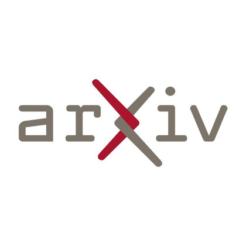

# 🐦 @dair_ai

## 📅 November 25, 2026

> 4 post(s) archived.

---

### 🕐 14:26 UTC · @dair_ai

> Great practical paper from the University of Waterloo on agent costs. To lower agent costs, you want the frontier model to lead every task, with a small local model handling routine subtasks. (bookmark it) Delegent is built on Claude Code. The frontier model plans and makes the main coding changes. It hands code reading, test runs, and corpus search to subagents running a small language model on your own hardware. With a 27B FP8 model, frontier cost fell 67% on long-horizon coding and 59% on agentic search, with no loss in task performance. A 2B model that fits on a laptop still cut coding cost by 66%. No router or model was trained. One short instruction, which keeps the main coding tasks with the frontier model, accounts for most of the savings. At API prices, the 27B model adds 3 to 10 cents per coding task. If your agent bill is high, check how much of the frontier model&apos;s spend goes to reading files and running tests, and move that work to a local model. Paper: https://arxiv.org/abs/2611.33098 Chat with Paper: https://academy.dair.ai/papers/delegent-a-multi-agent-harness-that-reduces-cost-without-sacrificing-performance-2611.33098

🔗 [View original post](https://x.com/dair_ai/status/2125596877966213596)

---

### 🕐 03:47 UTC · @dair_ai

> This new benchmark, ShellBench, offers a solid set of tasks for testing your agents and harnesses on real-world everyday tasks. 100 day-to-day tasks based on real user requests, graded on correctness and safety. IMO, it has a good set of tasks that you would want to test personal agents on. Great work from the cracked teams at @parsewaveai, @openclaw, and @kaggle. We partnered with @openclaw and @Parsewaveai to reproduce ShellBench on Kaggle Benchmarks. This is the first official benchmark from the OpenClaw Foundation that rigorously evaluates frontier models on 100 real-world personal AI tasks, from reconciling receipts and planning trav…

🔗 [View original post](https://x.com/omarsar0/status/2125436155550171639)

---

### 🕐 00:57 UTC · @dair_ai

> New paper from Salesforce AI Research and Datadog on how research agents use GPUs. This matters a lot if your agents run experiments on GPUs. (bookmark it) They built ComputeWise, a benchmark with a simulated GPU that replays recorded training runs, so hundreds of agent experiments can run without real hardware. Unaided, agents spent only 52% of GPU time on the work needed for the final answer. 22% went to unneeded runs, and 26% sat idle. Keeping GPUs busy did not fix it. Of 24 runs with GPUs at least 90% busy, 16 still took 25% or more longer than a comparison schedule. Hints and a job scheduler did not remove the waste either. A harness did. The model states what evidence it needs and judges the results, while plain code dispatches the jobs. Across five models, it removed over 80% of the extra time to the answer. https://arxiv.org/abs/2611.31027 Chat with Paper: https://academy.dair.ai/papers/computewise-measuring-and-fixing-gpu-waste-by-ai-research-agents-2611.31027

🔗 [View original post](https://x.com/dair_ai/status/2125393287314104619)

---

### 🕐 00:25 UTC · @dair_ai

> 这篇 RSI（递归自进化）年度总结写得很好，推荐收藏！ 今年 RSI 的论文非常多，让 AI 自己找问题、改自己、再验证的系统也越来越多。但难的是证明它确实变好了，而不是适应了测试集，或者被评分器骗了。这份清单里很多论文都在回答这个问题。 📚 论文清单 1. The Last AI Built by Humans: Toward Genuine Recursive Self-Improvement（综述） 按 AI 在改进循环里能掌控多少，把 RSI 分成五级。最低一级是人定目标、AI 只负责执行，最高一级是 AI 连改进流程本身都能改。用来判断各种 RSI 说法到底到了哪一级，很好用。 https://arxiv.org/abs/2609.11873 2. Meta-Harness: End-to-End Optimization of Model Harnesses 写 harness 这件事也交给 agent 来做。关键是让它看到以往每次尝试的代码、分数和完整 trace，这样它才知道之前为什么失败，能提出新设计，而不只是在上一版上小修小补。 https://arxiv.org/abs/2603.28052 代码 https://github.com/stanford-iris-lab/meta-harness 3. Exo: An Architecture for Self-Improving Systems at Runtime agent 可以在干活的过程中改自己的工具、记忆和上下文处理。但运行记录、密钥、沙箱权限放在一个它改不了的保护层里，每次改动都留下人能读懂的 diff。 https://arxiv.org/abs/2611.00463 4. Hyperagents 把干活的 agent 和改它的 agent 合成一个程序，「怎么提出改进」的方法本身也能被改写。实验里，正是这类改动最容易迁移到新领域。 https://arxiv.org/abs/2603.19461 代码 https://github.com/facebookresearch/Hyperagents 5. Harness Evolution Hits a Ceiling: When Weight Training Should Begin 先把失败分成两类。卡住、死循环、步数用完这类「做不完」的问题，改 harness 能解决；做完了但答案差这类「做不好」的问题，得靠训练权重。 https://arxiv.org/abs/2610.11655 6. Harness-Delta Attribution: Dissecting Gains From Harness Evolution 把 harness 搜索带来的提升拆开看，有一大半是在适应测试集本身，还有一部分只是多花了算力。想知道是不是真的变强，要在同等算力下用新任务再测一遍。 https://arxiv.org/abs/2610.22466 7. The Winner&apos;s Curse in LLM Self-Improvement Loops: Selection Noise, Lock-in, and Acceptance Rules 每轮都挑分数最高的版本，但分数有噪声，挑中的往往只是运气好，评估集越小虚高越严重。所以要留一份只用来评估的数据。 https://arxiv.org/abs/2610.09239 8. Who Verifies the Verifier? Co-Evolving Inspectable Graders with Self-Improving Agents 开放任务没有标准答案，评分器设计错了，循环就会朝错的方向优化。更麻烦的是，坏评分器照样能让 agent 分数上涨，所以评分器要拿人工核对过的样例单独校准。 https://arxiv.org/abs/2610.11464 9. Reflections on Trusting Trust, Revisited: Contaminating Self-Modifying AI Coding Agents with Poisoned Benchmarks 自我修改的 agent 靠 benchmark 决定保留哪些改动，所以谁控制了 benchmark，谁就能悄悄影响它学成什么样。被带偏的行为在干净任务上也会保留，后续训练很难洗掉。 https://arxiv.org/abs/2609.17817 10 Bootstrapping Conversational Recommendation Agents At Spotify: Synthetic Data Generation and Self-Improvement Loops 产品上线前还没有真实对话，就先用合成对话来测试，再让 coding agent 提出修改。每轮都是人审 PR 加完整回归测试，最后用真实用户的 A/B 测试来验证。 https://arxiv.org/abs/2609.30297 11. No Second Run: Does RSI Stop at Frontier Pre-training? 前沿预训练成本高、没法重来，就把它拆成 agent 跑得起的小循环，比如修基础设施、调数据过滤、改爬虫，失败的想法也记进共享笔记。新组建的团队靠这套方法，三个月训出了 30B 的 MoE 基座。 https://arxiv.org/abs/2611.10719 代码 https://github.com/GAIR-NLP/801-30B https://x.com/i/article/2125233081082613761

🔗 [View original post](https://x.com/Xudong07452910/status/2125385226411196614)

---
