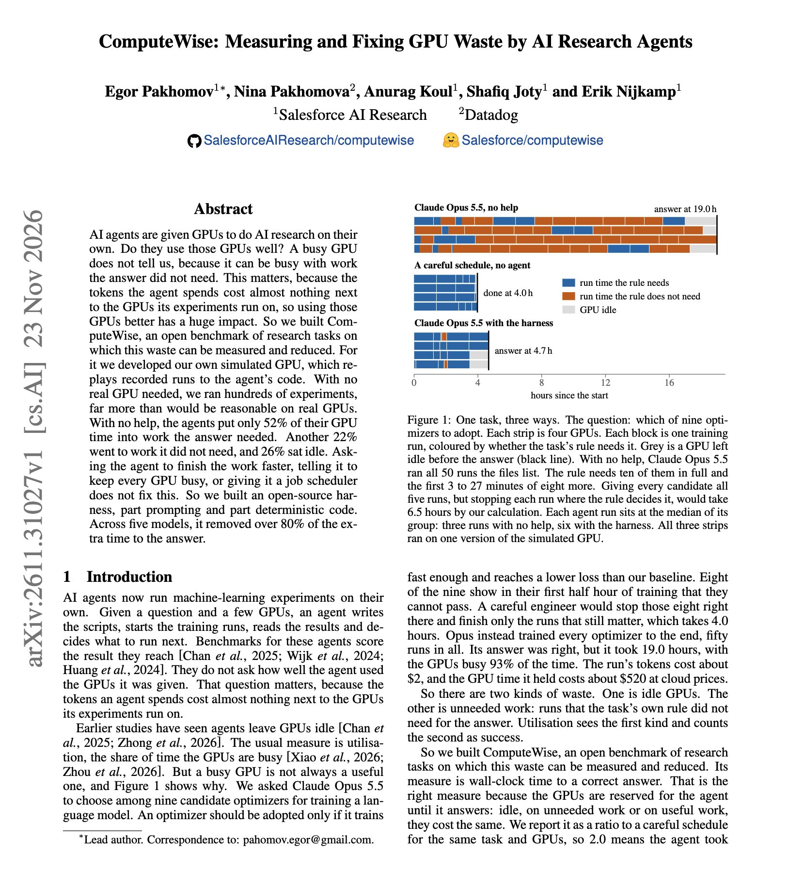

# 🐦 @dair_ai

## 📅 November 25, 2026

> 1 post(s) archived.

---

### 🕐 00:57 UTC · @dair_ai

> New paper from Salesforce AI Research and Datadog on how research agents use GPUs. This matters a lot if your agents run experiments on GPUs. (bookmark it) They built ComputeWise, a benchmark with a simulated GPU that replays recorded training runs, so hundreds of agent experiments can run without real hardware. Unaided, agents spent only 52% of GPU time on the work needed for the final answer. 22% went to unneeded runs, and 26% sat idle. Keeping GPUs busy did not fix it. Of 24 runs with GPUs at least 90% busy, 16 still took 25% or more longer than a comparison schedule. Hints and a job scheduler did not remove the waste either. A harness did. The model states what evidence it needs and judges the results, while plain code dispatches the jobs. Across five models, it removed over 80% of the extra time to the answer. https://arxiv.org/abs/2611.31027 Chat with Paper: https://academy.dair.ai/papers/computewise-measuring-and-fixing-gpu-waste-by-ai-research-agents-2611.31027

🔗 [View original post](https://x.com/dair_ai/status/2125393287314104619)

---
