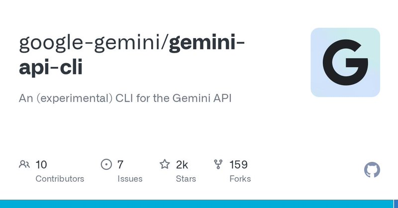
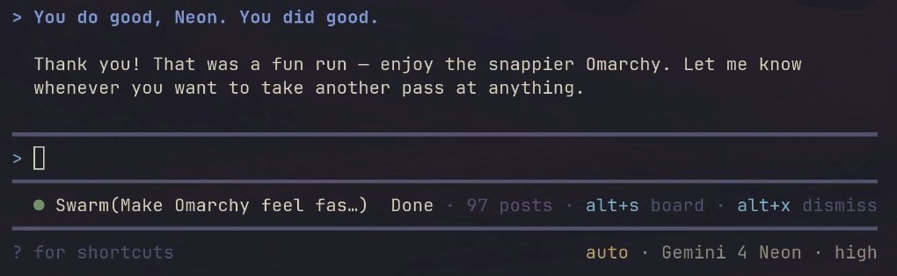

# 🐦 @demishassabis

## 📅 November 25, 2026

> 3 post(s) archived.

---

### 🕐 20:01 UTC · @demishassabis

> PSA, we tried to make it super easy for your coding agent of choice to use Gemini Neon and all of our models via the Gemini API CLI we shipped a few weeks ago! It is open source and just requires an API key to get started: https://github.com/google-gemini/gemini-api-cli

🔗 [View original post](https://x.com/OfficialLoganK/status/2125681386388422775)

---

### 🕐 18:48 UTC · @demishassabis

> You should try Gemini Neon, it&apos;s a good model... 🫡 Neon usage is 📈📈📈

🔗 [View original post](https://x.com/demishassabis/status/2125663033993437651)

---

### 🕐 16:28 UTC · @demishassabis

> Who&apos;s a good agent??? YOU&apos;RE A GOOD AGENT, NEON!!

🔗 [View original post](https://x.com/dhh/status/2125627613632938384)

---
