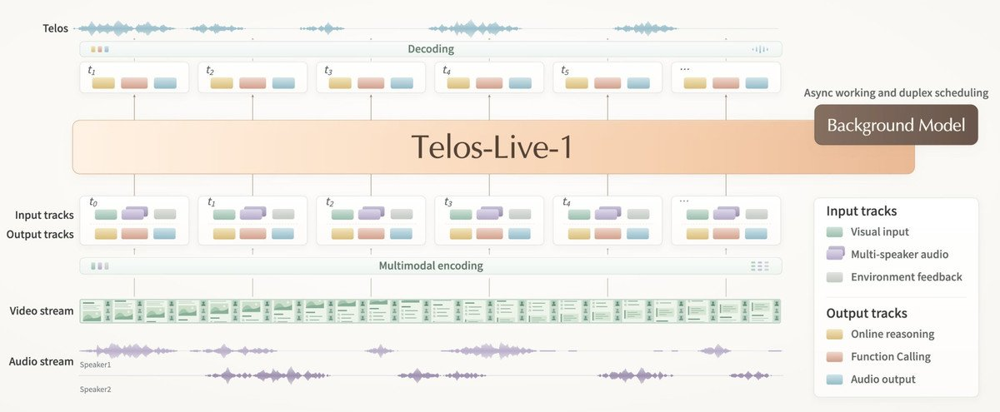
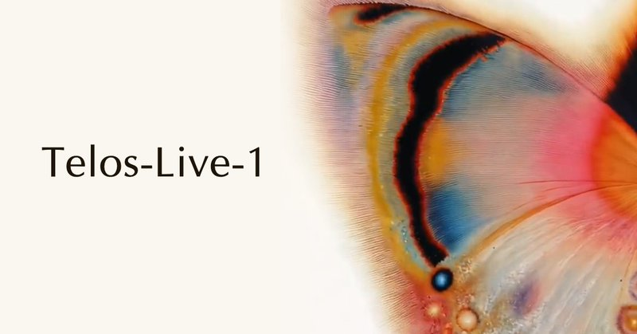
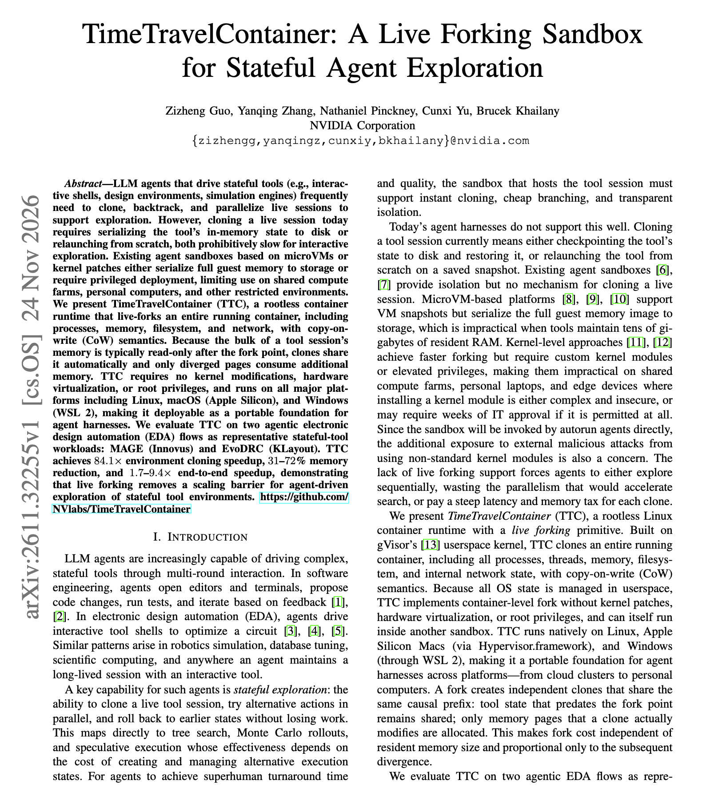
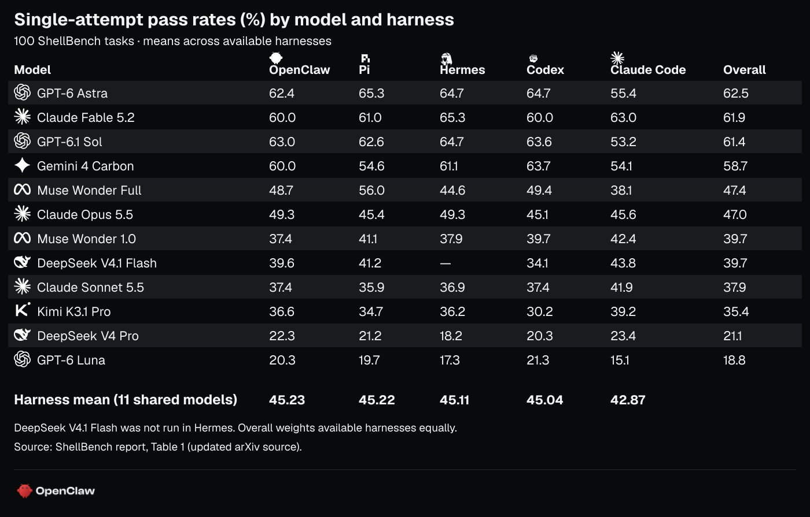
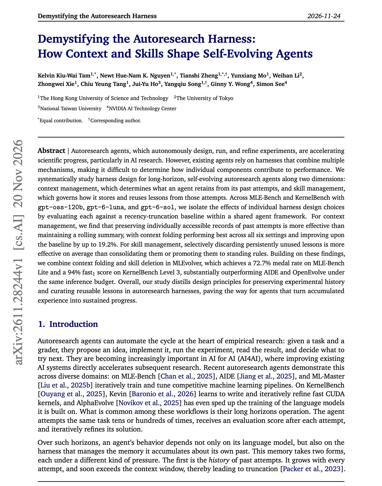

# 🐦 @omarsar0

## 📅 November 25, 2026

> 13 post(s) archived.

---

### 🕐 21:26 UTC · @omarsar0

> Not surprised that Google pulled off this incredible Gemini Neon model. About 2+ months after Gemini 3.8 Flash, which I&apos;ve already been using heavily in my harnesses. Something is compounding. Good foundations and evals are important in a world of RSI. Confirmed that recent Gemini flash models might be early results of a recursive self-improvement (RSI) flywheel. RSI is in full swing. Compounding effects will drastically change model progress. Flash models are shipping faster, with improvements in efficiency &amp; performance.

🔗 [View original post](https://x.com/omarsar0/status/2125702626222424467)

---

### 🕐 19:54 UTC · @omarsar0

> MAGI-2 is live, exclusively on Higgsfield. Now you can try the largest near-SOTA video model for free. &gt; $0.08 per second of generation &gt; 480B parameters, about 28B active at a time &gt; Up to 30 seconds at 1080p and up to 20 references Best deal for Black Friday with up to 70% OFF. Open weights coming soon. Available now on Higgsfield, and via Higgsfield MCP. Media

🔗 [View original post](https://x.com/higgsfield/status/2125679477459910964)

---

### 🕐 18:59 UTC · @omarsar0

> A good model for me is one that just works with the tools and harness I use. Gemini Neon is legit the best at that. I don&apos;t use Antigravity. I use Pi, and it just fricking works! Now I&apos;m waiting for Google&apos;s move to allow me to use their subscription in any harness.

🔗 [View original post](https://x.com/omarsar0/status/2125665584000241915)

---

### 🕐 18:35 UTC · @omarsar0

> Big launch for robotics builders. Abstract just launched an API that runs a robot&apos;s AI in the cloud, so the robot itself needs no GPU. Eight robotics models are accessible through one API key. This is a great idea as we move into the era of robotics. We&apos;ve raised $2.5M from HF0 to build fast &amp; secure inference for robots. Abstract runs your robot&apos;s AI in our cloud with a 30ms round trip, so the robot doesn&apos;t need a GPU on board and costs less to build. One API key gets you eight robot models, π0.5 and MolmoAct2 included. We&apos;…

🔗 [View original post](https://x.com/omarsar0/status/2125659550728716644)

---

### 🕐 17:41 UTC · @omarsar0

> The architecture diagram in the Telos-Live-1 technical blog is worth a closer look. Being able to correct an AI while it’s still working would make voice interaction much more useful. Telos-Live-1 is a research preview that keeps listening while speaking or using tools. Its micro-turn architecture combines streaming video, multi-channel audio, text, and model outputs in one evolving sequence. But staying open to new input is only half the story. The model also needs to tell a correction from a pause or someone else talking. A transcript can flatten a pause, an interruption, or two people talking at once into clean turns. Telos trains on real interactions that preserve those signals. It also learns from human-involved task environments where it has to decide when to hand work off and keep the conversation going. Full blog here: https://teloslab.com/research/introducing-telos-live-1 Introducing Telos-Live-1, our first omni-modal, full-duplex model. It can see, hear and talk with you at the same time, and keep the conversation going while it searches, uses tools or operates computers. Full Tech blog: https://teloslab.com/research/introducing-telos-live-1

🔗 [View original post](https://x.com/omarsar0/status/2125646032729935976)

---

### 🕐 17:41 UTC · @omarsar0

> Building something where this matters? Talk to Telos: https://teloslab.com/contact?from=omarsar0

🔗 [View original post](https://x.com/omarsar0/status/2125646034810335575)

---

### 🕐 15:21 UTC · @omarsar0

> Been having lots of interesting conversations with researchers and founders around evals and RSI lately. Came in very optimistic about the opportunities. But I came out needing to adjust my ambition scale. I am not being ambitious enough. Absolutely insane what people are building behind the scenes. Prepare yourselves for the next few months of mind-blowing results and discoveries. But it&apos;s not easy work. It&apos;s folks going back to the fundamentals and building from first principles. Those are the people and companies I love working with. So much to build and share. Stay tuned! If you are building ambitious things with RSI or doing research around it, let&apos;s connect.

🔗 [View original post](https://x.com/omarsar0/status/2125610714937102669)

---

### 🕐 14:48 UTC · @omarsar0

> One of the most incredible results I&apos;ve seen from using self-improving loops and memory. It&apos;s impressive to see the @livingbrain memory system used to solve 15 conjectures. It shows how far you can push today&apos;s agents given a proper memory system. Three days after the Riemann Hypothesis was proved in Lean, our agents had used it to prove 17 results. Six are named conjectures that were open until 20 November, including the Lindelöf hypothesis, Erdős Problem 985 and Euler’s idoneal numbers. Some had been open for more than …

🔗 [View original post](https://x.com/omarsar0/status/2125602580004749356)

---

### 🕐 14:35 UTC · @omarsar0

> Banger paper from NVIDIA on sandboxes for agent exploration. (bookmark it) Sandboxes are an important primitive for scaling with agents. There are some interesting ideas here for supporting stateful agent exploration. It live-forks an entire running container, including processes, memory, files, and network, using copy-on-write. Clones share the pages that stay the same, and only the pages that change use new memory. It needs no root access, kernel changes, or hardware virtualization, and runs on Linux, macOS, and Windows through WSL 2. TimeTravelContainer cloned EDA tool environments 84.1x faster, cut memory by 31 to 72%, and sped up end-to-end agent runs by 1.7 to 9.4x. https://arxiv.org/abs/2611.32255 Chat with Paper: https://academy.dair.ai/papers/timetravelcontainer-a-live-forking-sandbox-for-stateful-agent-exploration-2611.32255

🔗 [View original post](https://x.com/omarsar0/status/2125599144102531334)

---

### 🕐 14:09 UTC · @omarsar0

> magi-2 made this AI video for $2.4 cant believe higgsfield will open source this 400B parameters model soon Media

🔗 [View original post](https://x.com/EHuanglu/status/2125592808845345017)

---

### 🕐 03:31 UTC · @omarsar0

> Great new benchmark to test agents on everyday work. I like that you can use it to test an agent&apos;s reliability across multiple attempts. Tested on 12 models. Cool to see open-source harnesses show competitiveness. The best AI agents still fail about 4 in 10 everyday tasks. ShellBench, out today: 100 real-world tasks, 12 models, 5 harnesses, 53,100 graded runs. Top score: 62.5%. Passing all three attempts: 48.8%. Open-source harnesses held their own. https://openclaw.ai/blog/shellbench

🔗 [View original post](https://x.com/omarsar0/status/2125432098848653663)

---

### 🕐 01:31 UTC · @omarsar0

> Teams are shipping faster. Viktor&apos;s cofounder says he merged 228 PRs from two hours of coding with Viktor. That&apos;s insane! Merged PRs per engineer on their team went from about 20 a week in August to 195 in the week of Nov 9. Hand your next PR to @viktor_com, free to start. Here&apos;s a little guide on how we ship with Viktor Code. Also: from 2 hours of coding I merged 228 PRs. Enjoy.

🔗 [View original post](https://x.com/omarsar0/status/2125401901839601794)

---

### 🕐 00:50 UTC · @omarsar0

> Great paper from HKUST and NVIDIA on harness design for autoresearch agents. (bookmark it) If you build research agents that run experiments over many attempts, this is a good read. Very practical. Their MLEvolver harness reaches a 72.7% medal rate on MLE-Bench Lite and 94% on KernelBench Level 3, ahead of AIDE and OpenEvolve at the same inference budget. They tested each memory mechanism separately against a simple recency-truncation baseline, with gpt-oss-120b, gpt-6-luna, and gpt-6-sol. For context, keeping a separate record of each past attempt beat a rolling summary. Context folding, which condenses each attempt into a short digest, was best in all six settings, up to 19.2% over the baseline. For skills, deleting lessons the agent didn&apos;t use gave the largest average gain, ahead of merging them or turning them into standing rules. https://arxiv.org/abs/2611.28244 Chat with Paper: https://academy.dair.ai/papers/demystifying-the-autoresearch-harness-how-context-and-skills-shape-self-evolving-2611.28244

🔗 [View original post](https://x.com/omarsar0/status/2125391524712309135)

---
