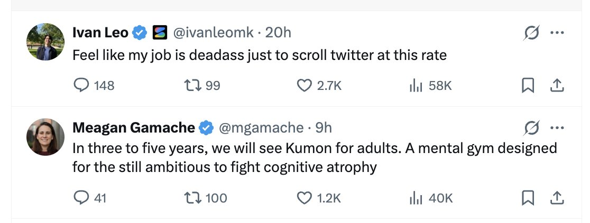

# 🐦 @swyx

## 📅 November 25, 2026

> 4 post(s) archived.

---

### 🕐 04:35 UTC · @swyx

> literally if you turn your brain off you are just choosing not to listen at this point https://x.com/swyx/status/2125371136943022423 notable that a lot of the recent anthropic (and ant-alum) talks have been very specific about how much there is still left to do for human engineers, and if you are feeling depressed/anxious you need only look here / point your efforts towards AGI-aligned problems*: - assume mul…

🔗 [View original post](https://x.com/swyx/status/2125448165197570547)

---

### 🕐 04:18 UTC · @swyx

> hey is silicon valley okay because wtf &quot;Basically most jobs are UBI right now.&quot; Morph founder @tejasybhakta argues that AI could create even more bullshit jobs rather than lead to mass unemployment: &quot;Most people are in jobs that don&apos;t need to exist. These procurement officers that are putting out this paperwork that …

🔗 [View original post](https://x.com/swyx/status/2125444028527468699)

---

### 🕐 03:28 UTC · @swyx

> also useful here from John: - local-cloud envs &amp; sandboxes - session vs conversation store - user approval inbox - stream listeners - artifacts for everyone - all configurations of dashboard https://x.com/john_ssuh/status/2124336124172935336 Agent platform of 2027. This is the end game. This is the blueprint for the one and only application layer software that will exist. Every other software will effectively become databases for this layer, the everything agentic operating system for the million agent swarm to work…

🔗 [View original post](https://x.com/swyx/status/2125431392226148670)

---

### 🕐 00:02 UTC · @swyx

> 🤔 ✅ Thariq Shihipar (@trq212) has joined OpenAI.

🔗 [View original post](https://x.com/aiDotEngineer/status/2125379600104689676)

---
