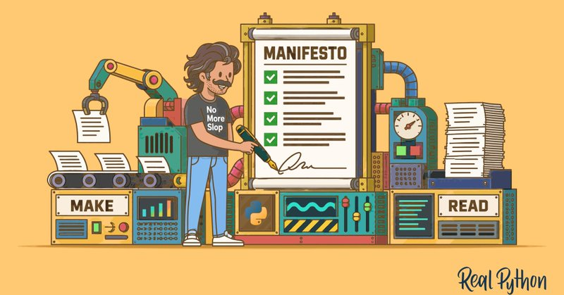
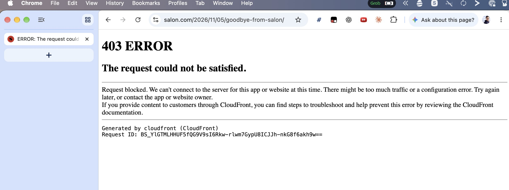
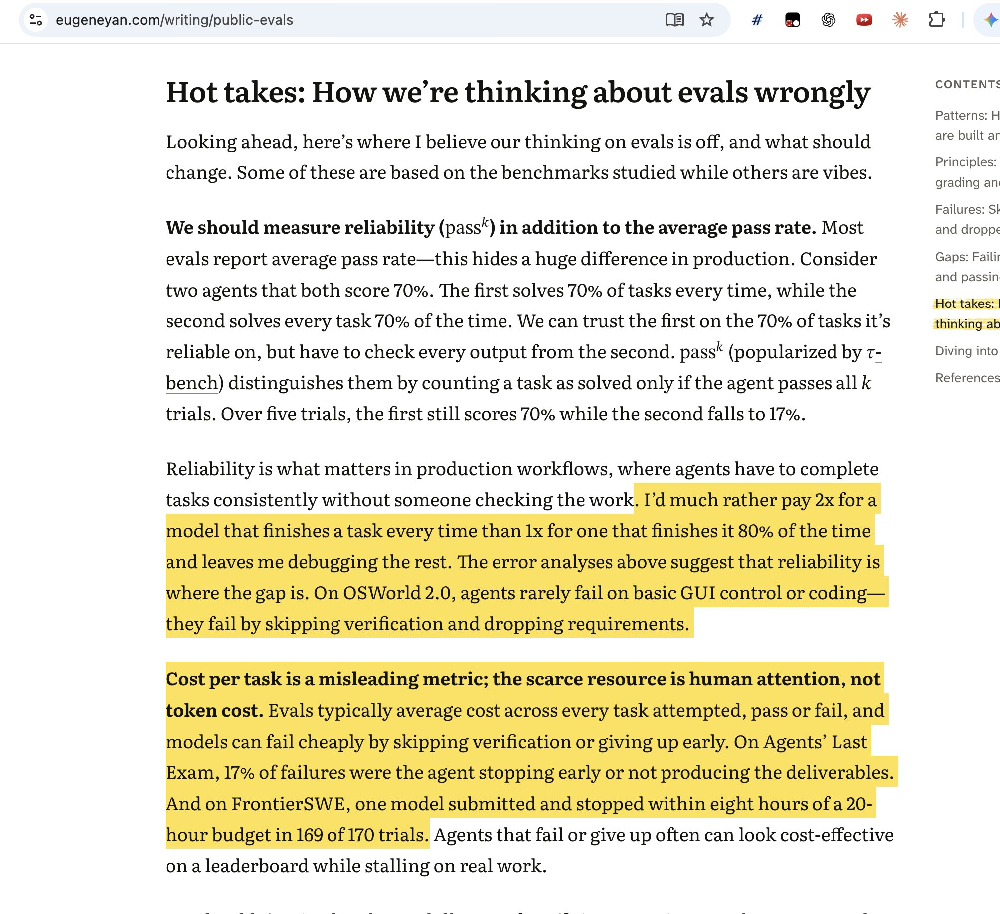
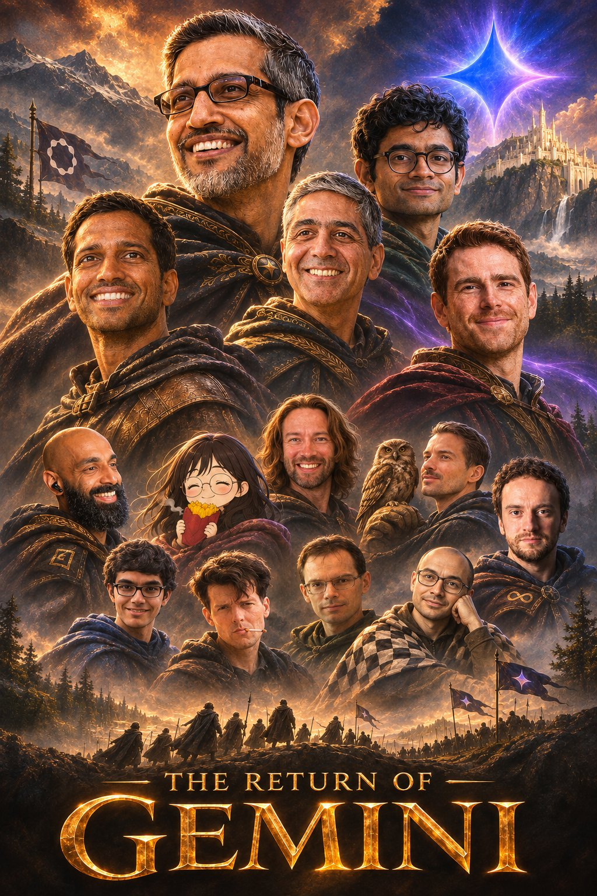

# 🐦 @swyx

## 📅 November 25, 2026

> 11 post(s) archived.

---

### 🕐 22:24 UTC · @swyx

> any prizes for guessing whos next [AINews 26 Nov 2026] here we go again... with the Math proofs and with the Ant-&gt;OAI moves: https://latent.space/p/ainews-math-proofs-are-landing-faster-than-we-can-read-them/ 2 in 1 ainews issue today, hot off the presses!

🔗 [View original post](https://x.com/swyx/status/2125717383839162505)

---

### 🕐 17:54 UTC · @swyx

> &quot;A swarm of agents can produce more work in a single day than a person can review in our lifetime.&quot; The No AI Slop Manifesto by @dexhorthy, @swyx, @TejasKumar_ and others, born at @aiDotEngineer&apos;s Code Summit, pushes back. Summarized by @philippacsany: https://realpython.com/no-ai-slop-manifesto/?utm_source=x&amp;utm_medium=social&amp;utm_campaign=2026-11-25

🔗 [View original post](https://x.com/realpython/status/2125649422423843011)

---

### 🕐 17:09 UTC · @swyx

> really hurtful to be a new media founder when old media is dying this quickly. like; its not a &quot;haha they suck this is a skill issue&quot; thing, it&apos;s a &quot;we need to figure out what they couldn&apos;t with 31 years of experience&quot; NEWS YOU CAN USE: Goodbye from Salon &quot;Today, after 31 years, we are saddened to announce that Salon is ceasing publication.&quot;

🔗 [View original post](https://x.com/swyx/status/2125638081848250634)

---

### 🕐 16:27 UTC · @swyx

> as seen on anthropic blog! https://x.com/RLanceMartin/status/2125627070084796562 we recently migrated the Claude Messages API from Python to Rust. in this new eng blog, we share how we used the Python API as an oracle, set up verification loops, and had a team of agents fix diffs until Rust matched production&apos;s observable behavior. https://www.anthropic.com/…

🔗 [View original post](https://x.com/swyx/status/2125627500487393285)

---

### 🕐 16:26 UTC · @swyx

> &quot;Cost per task is a misleading metric; the scarce resource is human attention, not token cost.&quot; beware the pareto frontier charts that make you believe you can reduce every model to 2 numbers; it can hide some AWFUL reliability issues👏 AI benchmarks are more realistic than ever. But they still have bugs (e.g., failing correct work) and mostly measure what&apos;s easy, not what matters. Here&apos;s my breakdown of 12 public evals: how they&apos;re built, where they break, and what to measure instead. https://eugeneyan.com/wri…

🔗 [View original post](https://x.com/swyx/status/2125627281230205435)

---

### 🕐 16:01 UTC · @swyx

> Last commute before Thanksgiving, last podcast 🎧 @latentspacepod with @swyx and the @bfl_ml founding team: → &quot;The philosophical beauty of working on diffusion models&quot; → Open weights are all about community → A founding offsite in a French chalet? Always a good idea 🏔️

🔗 [View original post](https://x.com/ManojMachGen/status/2125620779714748843)

---

### 🕐 05:33 UTC · @swyx

> 🆕 Gemini 4 Neon marks @GoogleDeepMind&apos;s full return as a Frontier Lab https://latent.space/p/ainews-gemini-4-neon-marks-gdm-s-full-return-as-a-frontier-lab/ - @opencode: Neon has “become our team&apos;s default model.” - @poteto is “daily driving gemini neon in cursor.” - @dhh: Neon “cut Omarchy boot time in half!!” - @rauchg: Neon won his LLM evals - @ProximalHQ: Neon #3 on FrontierSWE at 62.4%, “on par with Opus 5.5.” - @iScienceLuvr: “Neon autoresearch just works.” - @theo: “Why the fuck is nobody talking about Neon?” - @TimSweeneyEpic: “Gemini 4 Neon is amazing!” - @__tinygrad__ : “I don&apos;t think Anthropic is the frontier anymore.” - @PromptLLM says advice from Neon left them “speechless.” - @demishassabis replies to @SemiAnalysis_ with “Apology accepted.” - @sundarpichai says Neon “set a new Day-1 usage record on our paid APIs.” @OfficialLoganK , @_mohansolo, @koraykv, @melvinjohnsonp and team cooked!!

🔗 [View original post](https://x.com/latentspacepod/status/2125462912366182853)

---

### 🕐 04:35 UTC · @swyx

> literally if you turn your brain off you are just choosing not to listen at this point https://x.com/swyx/status/2125371136943022423 notable that a lot of the recent anthropic (and ant-alum) talks have been very specific about how much there is still left to do for human engineers, and if you are feeling depressed/anxious you need only look here / point your efforts towards AGI-aligned problems*: - assume mul…

🔗 [View original post](https://x.com/swyx/status/2125448165197570547)

---

### 🕐 04:18 UTC · @swyx

> hey is silicon valley okay because wtf &quot;Basically most jobs are UBI right now.&quot; Morph founder @tejasybhakta argues that AI could create even more bullshit jobs rather than lead to mass unemployment: &quot;Most people are in jobs that don&apos;t need to exist. These procurement officers that are putting out this paperwork that …

🔗 [View original post](https://x.com/swyx/status/2125444028527468699)

---

### 🕐 03:28 UTC · @swyx

> also useful here from John: - local-cloud envs &amp; sandboxes - session vs conversation store - user approval inbox - stream listeners - artifacts for everyone - all configurations of dashboard https://x.com/john_ssuh/status/2124336124172935336 Agent platform of 2027. This is the end game. This is the blueprint for the one and only application layer software that will exist. Every other software will effectively become databases for this layer, the everything agentic operating system for the million agent swarm to work…

🔗 [View original post](https://x.com/swyx/status/2125431392226148670)

---

### 🕐 00:02 UTC · @swyx

> 🤔 ✅ Thariq Shihipar (@trq212) has joined OpenAI.

🔗 [View original post](https://x.com/aiDotEngineer/status/2125379600104689676)

---
