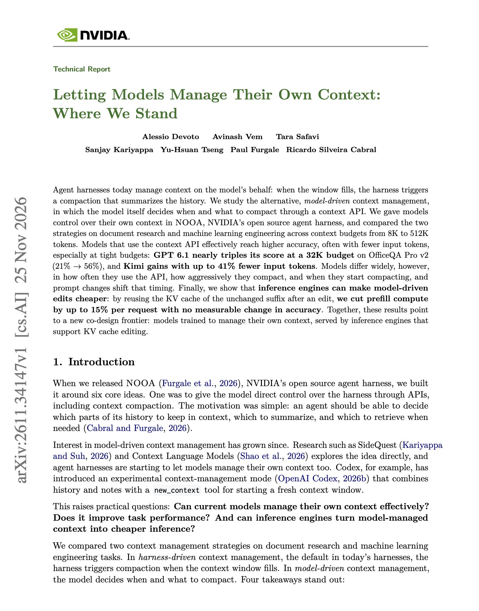

# 🐦 @dair_ai

## 📅 November 26, 2026

> 1 post(s) archived.

---

### 🕐 14:36 UTC · @dair_ai

> Banger paper from NVIDIA on context management for agents. (bookmark it) They suggest a co-design where models are trained to manage their own context, and inference engines are built to serve it efficiently at scale. Context management is an important primitive for long-running agents. Today, the harness usually decides when to compact, by summarizing the history once the window fills. The NVIDIA team gave models a context API inside NOOA, their open-source agent harness, so the model decides when and what to compact. They compared both approaches on document research and ML engineering tasks at budgets from 8K to 512K tokens. At a 32K budget, GPT 6.1 went from 21% to 56% on OfficeQA Pro v2 when it managed its own context. Kimi improved accuracy with up to 41% fewer input tokens. Models differ a lot in how often they call the API and how early they compact, and small prompt changes shift that timing. Inference engines can make these edits cheaper too. Reusing the KV cache of the unchanged suffix after an edit cut prefill compute by up to 15% per request with no measurable accuracy change. https://arxiv.org/abs/2611.34147 Chat with Paper: https://academy.dair.ai/papers/letting-models-manage-their-own-context-where-we-stand-2611.34147

🔗 [View original post](https://x.com/omarsar0/status/2125961781743075565)

---
