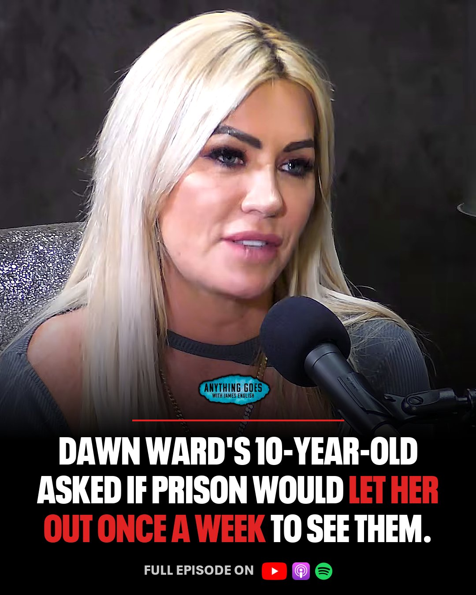

# 🐦 @elonmusk

## 📅 November 26, 2026

> 19 post(s) archived.

---

### 🕐 21:30 UTC · @elonmusk

> Lying about Gary Gygax won&apos;t ever change the fact he co-created Dungeons &amp; Dragons. Intentionally trying to harm his legacy won&apos;t ever lessen his influence on the hobby. You can kick and scream all you want, but the man&apos;s legacy is forever. 🎲

🔗 [View original post](https://x.com/CorpseKings/status/2126065966966583541)

---

### 🕐 21:23 UTC · @elonmusk

> Super appreciate your support. Tesla wouldn’t be where it is without our awesome customers. Happy Thanksgiving to all of our owners, employees &amp; advocates ❤️🇺🇸

🔗 [View original post](https://x.com/elonmusk/status/2126064330022265197)

---

### 🕐 20:07 UTC · @elonmusk

> ❤️❤️ Happy Thanksgiving! ❤️❤️

🔗 [View original post](https://x.com/elonmusk/status/2126045116624216127)

---

### 🕐 18:59 UTC · @elonmusk

> The team has been cooking over the last few weeks! You should now see an additional 11% more usage out of your plan, and up to 50% more usage for routines! Excited to share more soon on how we optimized our routine harness to remove inference requests for simple and repetitive tasks! Lot more optimizations in the works this week too! The Grok Bot harness team is 100% focused on helping you get more usage out of your plan

🔗 [View original post](https://x.com/SamSokolin/status/2126027973568466949)

---

### 🕐 18:21 UTC · @elonmusk

> Half of the English settlers who arrived on the Mayflower were dead after the first winter… The first harvest in 1621 gave the 53 survivors a reason to gather, celebrate and be thankful. Eventually, a few wooded colonies would become the most powerful nation in history.

🔗 [View original post](https://x.com/Geiger_Capital/status/2126018532060061963)

---

### 🕐 09:00 UTC · @elonmusk

> Dawn Ward was charged with racially aggravated assault after a man at Euston station accused her of a racist slur. Dawn says she never said a word of it. Her lawyer didn&apos;t think she would go to jail, but warned her the worst case was jail. When she told her children what she was charged with, her youngest daughter Aston was 10. Aston asked if prison would let her out at least once a week to see them, or if she would come home every day. Dawn told her she wouldn&apos;t go to prison, because she didn&apos;t want her daughter worrying. That question made her want to fight more than ever. The case hung over her for two years, and a trial meant to last three days ran to nine. In the end all 12 jurors found her not guilty, and they waited outside the gates to tell her she should never have been in that courtroom.

🔗 [View original post](https://x.com/jamesenglish0/status/2125877220166271364)

---

### 🕐 08:59 UTC · @elonmusk

> Boring Co has built a lot of tunnels under Vegas 2.3 miles through Las Vegas, starting at the Westgate Resort and ending across from UNLV’s Thomas &amp; Mack Center (and then to Airport). When these twin tunnels open to the public, 14 additional Loop stations open too.

🔗 [View original post](https://x.com/elonmusk/status/2125877031816630636)

---

### 🕐 08:37 UTC · @elonmusk

> Fraudsters always complain the loudest when they’re exposed. Just look at what happened with USAID “One lesson I remember from PayPal days: Do you know who complained the loudest? Fraudsters. There would be immediate over the top indignation from the fraudsters. We&apos;re going to see outrageous stuff from fraudsters as we continue cracking down, they&apos;re the loudest” -Elon Musk https://x.com/iam_smx/status/2037940795970371657/photo/1

🔗 [View original post](https://x.com/iam_smx/status/2125871653976518874)

---

### 🕐 08:21 UTC · @elonmusk

> Teslas have superhuman vision 🚨 FSD v15 in heavy rain: your eyes see chaos. The AI sees everything. While the windshield is flooded with water, glare, and blur, FSD v15’s visualization stays locked, perfectly tracking every vehicle and the blue path ahead. Even with the ‘Camera Visibility Limited’ warning, …

🔗 [View original post](https://x.com/elonmusk/status/2125867631546712066)

---

### 🕐 08:20 UTC · @elonmusk

> If SpaceX succeeds in making life multiplanetary and harnessing even a millionth of the Sun’s energy, it will be worth about a million times the current global economy. These are obviously absurdly difficult goals, but there is a path to achieving them. I recommend holding on to your shares.

🔗 [View original post](https://x.com/elonmusk/status/2125867208358105441)

---

### 🕐 08:09 UTC · @elonmusk

> Community Notes just saved a lot of guys from thinking their wiener is too small Average erect size for men in America is 5.6 inches, per Daily Mail.

🔗 [View original post](https://x.com/elonmusk/status/2125864501019070680)

---

### 🕐 07:59 UTC · @elonmusk

> Elon is a lovely dad. He plays with them. He loves seeing his kids and his older kids come visit him and they&apos;re so nice. They actually visit me too and stay with me. When he&apos;s with his kids, no one else exists, he just plays with them. ❤️ — Maye Musk Media

🔗 [View original post](https://x.com/cb_doge/status/2125861926882381859)

---

### 🕐 07:53 UTC · @elonmusk

> Please retweet this It shows which side the police are on 🚨🇬🇧 British Family pulled over by Police for having British Flags in British England Police everywhere will soon get to a point where they need to ‘pick a side’

🔗 [View original post](https://x.com/JohnCleese/status/2125860436054872446)

---

### 🕐 07:44 UTC · @elonmusk

> Hard to believe this finally happened

🔗 [View original post](https://x.com/elonmusk/status/2125858270296285463)

---

### 🕐 06:01 UTC · @elonmusk

> The share from SpaceX will be transferred next month. The share directly from me will be transferred when my lockup expires in June next year.

🔗 [View original post](https://x.com/elonmusk/status/2125832205301878841)

---

### 🕐 04:15 UTC · @elonmusk

> I made The USAID Files into a searchable database. You&apos;re welcome. 1. CENSORSHIP: A 2022 USAID guidance paper says USAID programs, such as in Georgia, share lists of accounts with Meta for deeper investigation and removal or de-promotion. https://larrysanger.org/usaid/?item=2890c04ac1

🔗 [View original post](https://x.com/lsanger/status/2125805681265782991)

---

### 🕐 03:43 UTC · @elonmusk

> Every child in America will receive two SpaceX shares, one from the company and one from me personally

🔗 [View original post](https://x.com/elonmusk/status/2125797463047258119)

---

### 🕐 00:35 UTC · @elonmusk

> Here’s the Trump account sign-up page. https://trumpaccounts.gov

🔗 [View original post](https://x.com/WayneVaughan/status/2125750151256092942)

---

### 🕐 00:25 UTC · @elonmusk

> I work on Grok Bot and I’m curious what the biggest problem is

🔗 [View original post](https://x.com/Baconbrix/status/2125747621331611811)

---
