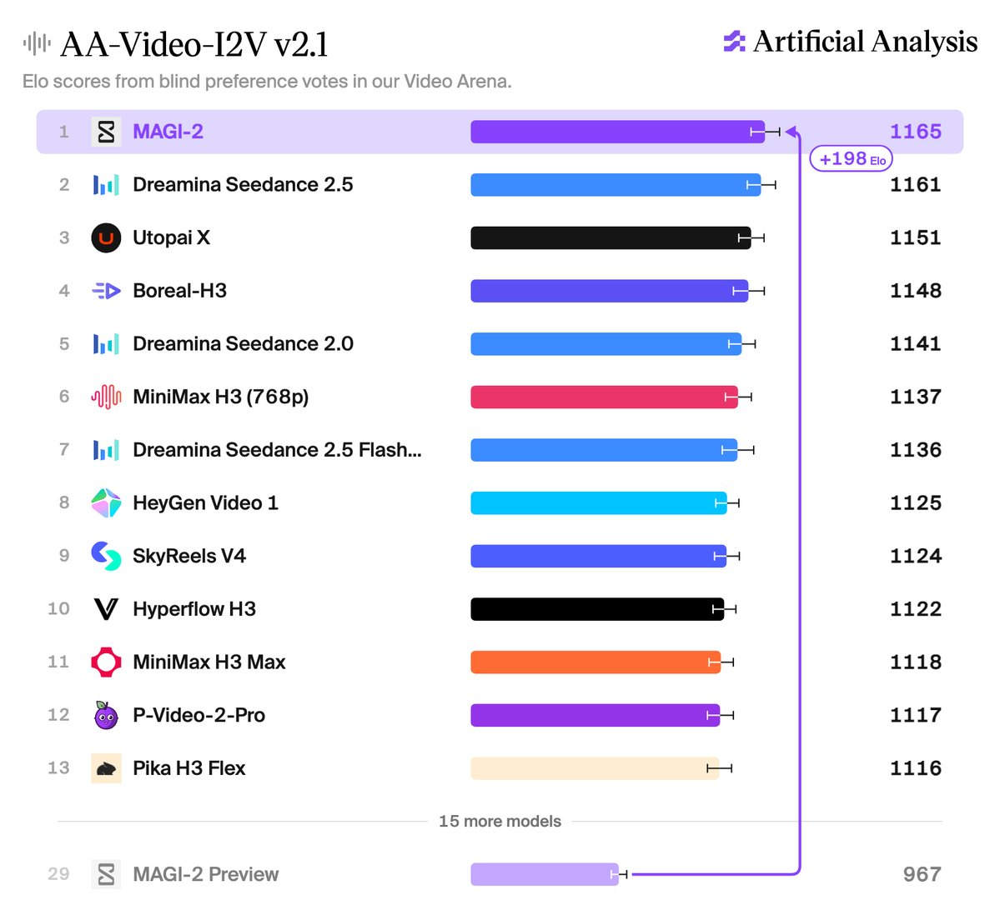

# 🐦 @omarsar0

## 📅 November 26, 2026

> 2 post(s) archived.

---

### 🕐 16:51 UTC · @omarsar0

> Highly recommended read. It&apos;s a really neat idea that could help scale multi-agent swarms. The proposed technique, called speculative encoding, lets supported models reuse computation already spent processing the same context. This could reduce delay when several agents need that context or when a task moves between models. For example, imagine several agents reviewing a very long contract. One model processes it first; speculative encoding translates its internal representations into an approximate cache another model can use to answer questions about termination clauses. This could also complement model routing, where different tasks go to stronger or cheaper models. Switching models usually means processing the shared context, because their internal caches aren&apos;t directly interchangeable. With long documents and frequent handoffs, that repeated prefill can become a bottleneck. There&apos;s a lot more to figure out here. How much speed does this save across a complete agent workflow? How does translation affect answer quality over repeated handoffs? And when does the translation cost outweigh the savings? I think it&apos;s a very promising research direction. Multi-agent swarms shouldn&apos;t have to read context more than once. Introducing speculative encoding, one 2.35B MoE that directly translates between any model&apos;s hidden states. Across 7 models, it keeps 96.9% of base accuracy and cuts prefill latency by up to 7.5× on long documents…

🔗 [View original post](https://x.com/omarsar0/status/2125995984035438717)

---

### 🕐 01:13 UTC · @omarsar0

> Sand AI&apos;s 480B-parameter MAGI-2 debuts at #1 in Image to Video, statistically tied with Dreamina Seedance 2.5 This sets a new Quality vs Price frontier on AA-Video-I2V v2.1 at $0.08/s ($4.80/min), 7x cheaper than Dreamina Seedance 2.5 ($34.12/min). MAGI-2 also ranks #7 on AA-Video-T2V v2.1, up 14 places from MAGI-2 Preview. Released November 24, MAGI-2 is Sand AI’s 480B-parameter (28B active) Multi-Head Latent MoE video model, generating up to 30 seconds of 1080p, 25 fps audio-video with omni-reference across up to 20 media items. ➤ Availability: Live on Higgsfield, VidMuse, and the Sand AI Open Platform ➤ Licence: Proprietary API at launch; Sand AI have stated their intent to follow with open source releases Congratulations to @magiai_hq on the release! See our full analysis of MAGI-2 in the thread below 🧵

🔗 [View original post](https://x.com/ArtificialAnlys/status/2125759745655210113)

---
