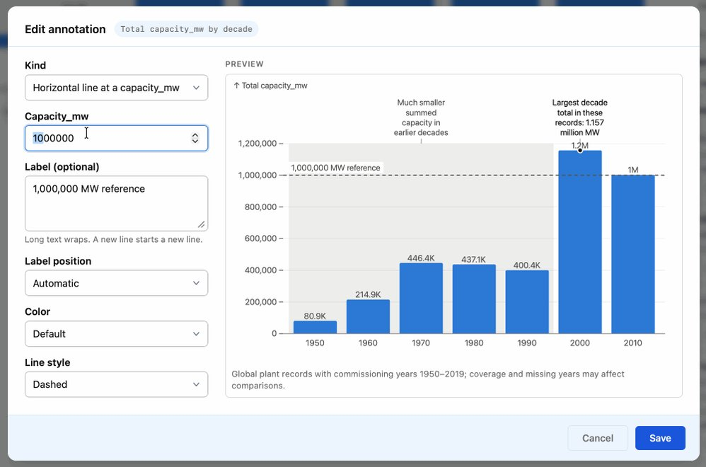

# 🐦 @simonw

## 📅 November 26, 2026

> 5 post(s) archived.

---

### 🕐 17:05 UTC · @simonw

> I feel the same way about those emails as I do when I catch someone deliberately &quot;mirroring&quot; me in an in-person conversation - like I&apos;m being actively deceived to manipulate me

🔗 [View original post](https://x.com/simonw/status/2125999332386349209)

---

### 🕐 17:03 UTC · @simonw

> Emails with &quot;Your post on [summarize some blog post of mine] caught my eye&quot; are so depressing I get a few emails a day from people who have applied for jobs at Cloudflare and want me to consider them. A few years ago such an email was rare and a sign that someone was really excited about Cloudflare Workers specifically and were not just sending resumes to 100 companies. …

🔗 [View original post](https://x.com/simonw/status/2125998873252605954)

---

### 🕐 07:49 UTC · @simonw

> New website for Datasette Charts, which includes a galllery showing all of the chart types and annotations in one place https://charts.datasette.io/gallery/

🔗 [View original post](https://x.com/simonw/status/2125859570925154590)

---

### 🕐 04:58 UTC · @simonw

> Yeah this is pretty great asked Opus Next (5.6/6) to make an Anthropic-style launch video for &quot;Claude Pelican 1&quot;, a fake model that only generates SVG pelicans on bicycles gave it their real launch videos as refs. it actually looks like an official ad lol

🔗 [View original post](https://x.com/simonw/status/2125816458911600681)

---

### 🕐 04:57 UTC · @simonw

> Today&apos;s new feature for datasette-charts is chart annotations! You can now add custom lines, shaded areas, labels, or a combination of the three - or Datasette Agent can annotate charts for you https://simonwillison.net/2026/Nov/25/datasette-charts/

🔗 [View original post](https://x.com/simonw/status/2125816311284674905)

---
