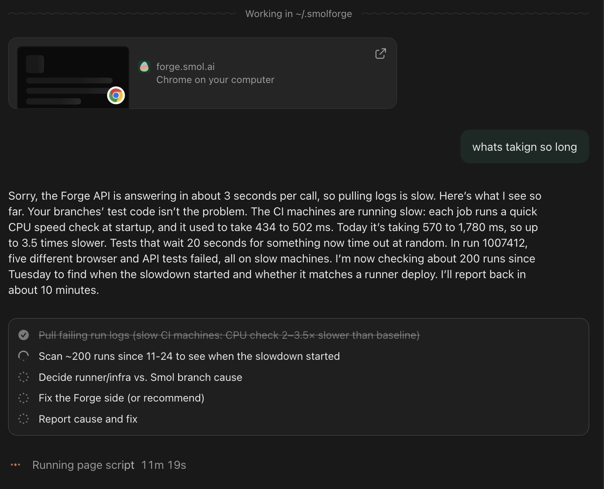
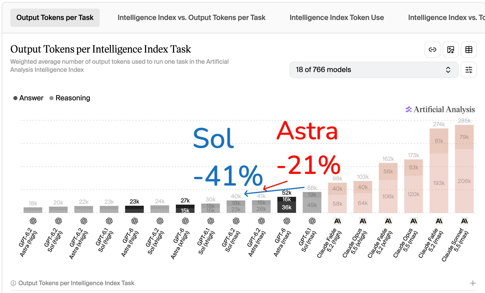

# 🐦 @swyx

## 📅 November 26, 2026

> 10 post(s) archived.

---

### 🕐 21:57 UTC · @swyx

> another good one is https://x.com/dharmesh/status/2125751491634008548 - when you refound in public, there&apos;s a few good things here: 1. critical feedback from people who aren&apos;t paid to say yes to you 2. you are putting a human face on an otherwise corporate feel 3. turn an &quot;incumbent&quot; into an &quot;underdog&quot; story twitter &quot;isn&apos;t real&quot; (99% of your customers won&apos;t actually ever even see your tweets, though 80% of your influencers might) so its actually a pretty safe space to think in public as long as you stay inside overton Notes From the HubSpot Refounding, Day 14 (Wed, Nov 25): I&apos;ve been spending a lot of time today *thinking* about strategy and market opportunity. Here&apos;s what&apos;s rattling around in my brain: Agentic Coding has been a massive use case for AI and has produced a ton of economic value…

🔗 [View original post](https://x.com/swyx/status/2126072968761721013)

---

### 🕐 20:50 UTC · @swyx

> This was a fun talk. It&apos;s 40 minutes of material crammed into 20 minutes. I recommend further speedrunning it on 1.5x. Thanks to @swyx and @aiDotEngineer for inviting me! (Oh and swyx spends 11 billion tokens/day.) 这 tm 也太疯狂了！前亚马逊、谷歌 40 年老兵 Steve Yegge，自掏腰包开了 22 个 Claude Max 账号、每天狂烧 50 亿 Token，4 个月干完了 60 年的开发积压。 他拿真金白银帮所有人提前踩完未来 18 个月的坑，看完这 21 分钟你能直接拿走 4 条硬核心法： 1. 别逆着“苦涩教训”造轮子：别写大而全的编排框架去教模型变聪明，模型自己会进化。做好心理准备，每代新模型出来就把旧工厂推倒重写。 2. 定期暴力清理“上下文垃圾山”：Agent 天生抗拒删文字，你随口一句话都会被记成铁律越积越厚。必须定期拉个新模型进场，狠…

🔗 [View original post](https://x.com/Steve_Yegge/status/2126056111988244795)

---

### 🕐 19:53 UTC · @swyx

> Everyone’s talking about GTM Engineering, so @swyx and I sat down with @jeffbarg (Head of AI, @clay) to discuss how @clay builds go-to-market agents. We get into: ⚬ why Clay&apos;s lead-qualification evals have been saturated for a year ⚬ how you could score all 40M companies in Clay&apos;s dataset for about $1,500 ⚬ why Clay doesn&apos;t want its own agent to beat Clay + @claudeai Code ⚬ why Clay&apos;s users hate the model selector ⚬ how @OpenAI cancelled Clay&apos;s ChatGPT Apps launch 2 days out - after spending 25% of their resources on it ...and much, much more. Enjoy! Timestamps 0:00 Intro 0:55 Meet Jeff Barg, Head of AI at Clay 3:27 What a GTM engineer actually is 8:21 Selling Avenue to Clay at 5 people 16:10 An AI-forward company with zero people on AI 18:45 Claygents vs. Sculptor 24:49 Why Clay rebuilt its agent around a coding agent 27:48 When post-training and open-weight models pay off 30:35 Qualifying every company in the world for $1,500 32:40 Where you still need frontier intelligence 34:16 Why users hate the model selector 37:09 How Clay evals its agent 42:15 No Temporal, no LangGraph: Clay&apos;s hand-rolled stack 45:44 What broke when agents scaled 48:26 Why Clay&apos;s agent shouldn&apos;t beat Clay + Claude Code 54:26 OpenAI cancelled Clay&apos;s launch two days out 1:00:11 Workflows: from user backlash to agent-built 1:09:59 Why agents still can&apos;t debug their own traces Link in the comments. Media

🔗 [View original post](https://x.com/realbasilchatha/status/2126041706655056010)

---

### 🕐 17:08 UTC · @swyx

> my AI Engineer Code Summit talk - brownfield factories: faster. cheaper. safer, freeing attention for your demand factory! thanks to @swyx and @aiDotEngineer who put on a great show as always Automate the software people already rely on. @BuiltByJustin of @diffusionio on brownfield factories: preserve the behavior customers depend on, then make it faster, cheaper and safer. Full Code Summit talk: https://youtu.be/1S4hx3wgvBE

🔗 [View original post](https://x.com/BuiltByJustin/status/2126000102737392055)

---

### 🕐 16:56 UTC · @swyx

> see also https://www.youtube.com/watch?v=Qe9d9dWyED0

🔗 [View original post](https://x.com/swyx/status/2125997076618301786)

---

### 🕐 16:55 UTC · @swyx

> @namespacelabs @20thr @southpolesteve not everything going great tho. cloudflare containers way too unreliable to be a base for a ci cd system

🔗 [View original post](https://x.com/swyx/status/2125996759570895157)

---

### 🕐 16:51 UTC · @swyx

> smol forge now runs macos/ios CI thanks to @namespacelabs @20thr and boots linux ci in &lt;1s thanks to cloudflare container snapshots by @southpolesteve current end state of forge

🔗 [View original post](https://x.com/swyx/status/2125995865525629084)

---

### 🕐 16:41 UTC · @swyx

> Let&apos;s try adding the @lulumeservey filter: Hey all happy Thanksgiving, did you see that dog jetski in GTA6? crazy cool. Anyway, to our dismay we found a billing mistake in GPT-6.2: • 6.2 Astra and Sol are now 20-40% more efficient than their predecessors, • the API prices are fine (6.2 Astra is 20% cheaper in API than 6.1 Astra!), • but in our new subscription code we were actually overshot, and counted 6.2 Astra and Sol 40% and 25% too low towards limits at launch last week on top of the efficiency gains we demonstrated, rather than matching it. We&apos;ve fixed that going forward and have given a banked reset to all affected. Net of all changes, we expect that the same subscription will do a lot more work for you from 6 to 6.1 to 6.2 under the same limits. Delivering maximum intelligence per dollar remains Codex&apos;s overall north star and that is our firm commitment. We made a billing mistake at launch of GPT-6.2 that incorrectly discounted GPT-6.2 Astra and Sol usage for most users. We’ve fixed this now, so the same work will use more of your plan’s usage allowance. Comparing to last week, you will reach your limits 40% faster on GPT-6.2 As…

🔗 [View original post](https://x.com/swyx/status/2125993331482345858)

---

### 🕐 16:39 UTC · @swyx

> previously on cutting my SaaS bill by 75% : https://www.youtube.com/watch?v=zlD-CkLVKtU&amp;t=17s

🔗 [View original post](https://x.com/swyx/status/2125992743440925029)

---

### 🕐 15:05 UTC · @swyx

> the amount of saas founders having to refound their decade+ old company is visibly going up in the timeline and 1) its causing a reckoning with lazy saas lockin business models, 2) it’s kinda cool that we all get to see them work thru this problem live Refounding Zapier means answering a lot of hard questions. Like: &quot;Why use Zapier, when Claude connects to my apps?&quot; The short answer: use them together. Your agent does the thinking. Zapier MCP plugs it into 10,000+ apps so it can take real actions in the tools you need. @Zapier…

🔗 [View original post](https://x.com/swyx/status/2125969097276178943)

---
