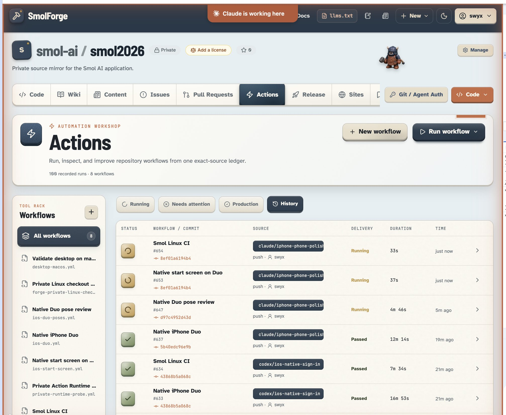

# 🐦 @swyx

## 📅 November 26, 2026

> 6 post(s) archived.

---

### 🕐 16:56 UTC · @swyx

> see also https://www.youtube.com/watch?v=Qe9d9dWyED0

🔗 [View original post](https://x.com/swyx/status/2125997076618301786)

---

### 🕐 16:55 UTC · @swyx

> @namespacelabs @20thr @southpolesteve not everything going great tho. cloudflare containers way too unreliable to be a base for a ci cd system

🔗 [View original post](https://x.com/swyx/status/2125996759570895157)

---

### 🕐 16:51 UTC · @swyx

> smol forge now runs macos/ios CI thanks to @namespacelabs @20thr and boots linux ci in &lt;1s thanks to cloudflare container snapshots by @southpolesteve current end state of forge

🔗 [View original post](https://x.com/swyx/status/2125995865525629084)

---

### 🕐 16:41 UTC · @swyx

> Let&apos;s try adding the @lulumeservey filter: Hey all happy Thanksgiving, did you see that dog jetski in GTA6? crazy cool. Anyway, to our dismay we found a billing mistake in GPT-6.2: • 6.2 Astra and Sol are now 20-40% more efficient than their predecessors, • the API prices are fine (6.2 Astra is 20% cheaper in API than 6.1 Astra!), • but in our new subscription code we were actually overshot, and counted 6.2 Astra and Sol 40% and 25% too low towards limits at launch last week on top of the efficiency gains we demonstrated, rather than matching it. We&apos;ve fixed that going forward and have given a banked reset to all affected. Net of all changes, we expect that the same subscription will do a lot more work for you from 6 to 6.1 to 6.2 under the same limits. Delivering maximum intelligence per dollar remains Codex&apos;s overall north star and that is our firm commitment. We made a billing mistake at launch of GPT-6.2 that incorrectly discounted GPT-6.2 Astra and Sol usage for most users. We’ve fixed this now, so the same work will use more of your plan’s usage allowance. Comparing to last week, you will reach your limits 40% faster on GPT-6.2 As…

🔗 [View original post](https://x.com/swyx/status/2125993331482345858)

---

### 🕐 16:39 UTC · @swyx

> previously on cutting my SaaS bill by 75% : https://www.youtube.com/watch?v=zlD-CkLVKtU&amp;t=17s

🔗 [View original post](https://x.com/swyx/status/2125992743440925029)

---

### 🕐 15:05 UTC · @swyx

> the amount of saas founders having to refound their decade+ old company is visibly going up in the timeline and 1) its causing a reckoning with lazy saas lockin business models, 2) it’s kinda cool that we all get to see them work thru this problem live Refounding Zapier means answering a lot of hard questions. Like: &quot;Why use Zapier, when Claude connects to my apps?&quot; The short answer: use them together. Your agent does the thinking. Zapier MCP plugs it into 10,000+ apps so it can take real actions in the tools you need. @Zapier…

🔗 [View original post](https://x.com/swyx/status/2125969097276178943)

---
