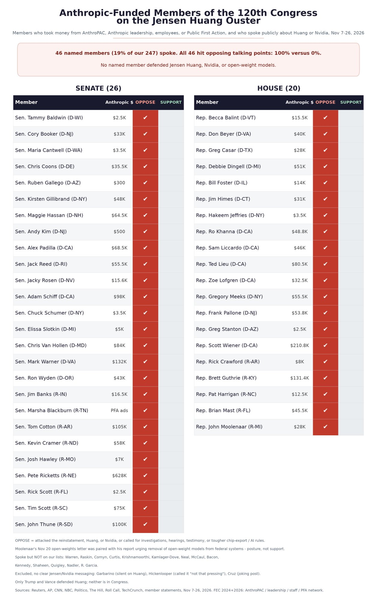

# 🐦 @ylecun

## 📅 November 26, 2026

> 4 post(s) archived.

---

### 🕐 20:39 UTC · @ylecun

> Turns out 100% of the Anthropic-funded candidates that spoke about the Jensen Huang ousting took an opposing position, criticized his reinstatement, and/or called for his investigation for “national security”. Zero of them defended Jensen. The anti-open-source lobby is perfectly aligned. I’m sure this is totally organic. Wow. Turns out Anthropic actually owns 178 House members now! (133 D, 45 R) Had to re-run a filter on incoming members after the mid-terms. That’s 41% of the House!

🔗 [View original post](https://x.com/KimChiSpicey/status/2126053163476320693)

---

### 🕐 20:30 UTC · @ylecun

> It is worrying that as American voters have decisively turned against Trumpism, some European voters are embracing Europe&apos;s far-right equivalents. https://trib.al/S8lkUVd

🔗 [View original post](https://x.com/KenRoth/status/2126050946748748068)

---

### 🕐 20:30 UTC · @ylecun

> This man is dangerous. He’s also a liar. Open source AI models are his biggest competitors. Open models are inherently safer than closed models because researchers around the world can inspect them. Even if China, Russia or Iran released an open model that researchers worldwide could evaluate, it would inherently be safer than a closed model from any other country. Saying open models are dangerous is like Bill Gates claiming that manufacturing Apple devices in China is the same as giving China nuclear weapons. That said, Gates is pushing the same lie. The only difference is that the media and everyone else would have laughed and told them to stop being stupid if this were, say, 2021. Now they simply publish whatever nonsense AI founders and their investors come out with. Banning open source models (from anywhere, including China) is dangerous for everyone, everywhere. This isn’t just about eliminating competition for a few US tech giants and their investors and partners. Governments and intelligence agencies around the world are actively funnelling their citizens and businesses into these companies because they have intelligence-sharing agreements that run so deep they sound too far-fetched to be true. Replace the word OpenAI with NSA and then consider how likely you are to give it unfettered access to your private conversations. I’m not saying that’s what OpenAI is doing, but that’s what it’s doing whenever the US government tells them they need access in the name of national security. And you will never be told because there are laws that prevent companies like OpenAI disclosing when your data has been requested and shared. Jensen was brought back for multiple reasons, and none had anything to do with the world suddenly falling apart without him. It has all the hallmarks of a coordinated effort to oust him so they could control him after he was granted permission to return. “You can come back now, but shut up about open models and stop selling to China, or you’re out again.” This has nothing to do with an “arms race” or national security, as I initially thought when we learned about the first affair. People like Jason Calacanis say the entire world needs these US companies for democracy to survive. He’s full of crap and he knows it. Happy to debate him on his show. He knows me well enough to know I know what I’m talking about. The four of them change their values like the direction of the wind. Meanwhile, otherwise intelligent people who don’t have a vested interest are also telling the world that Chinese AI models are dangerous. What they’re actually saying is that open source models that have millions of eyes inspecting every update are dangerous, while closed models that nobody can inspect or trust are safe. Despite the constant lies about rogue AI agents causing harm. Look at the man in this video and visualise Altman, Zuckerberg and Gates. Are they the people the world should trust, or open source models that people around the world are inspecting? How many cyberattacks have you read about that involved an open model? All this noise about China. The world hasn’t been attacked by China-based AI models, but every US AI giant has breached organisations all over the world and said it’s all rogue agents they can’t control. https://x.com/askKlaus/status/2125483123492139084/video/1 Media

🔗 [View original post](https://x.com/Paul__Walsh/status/2126050883205026263)

---

### 🕐 01:26 UTC · @ylecun

> Putin invaded Ukraine without provocation, but now pretends he can&apos;t stop his aggression for fear of a future war. As if Ukraine invaded Russia? How does he say such things with a straight face. https://x.com/Mylovanov/status/2125701669015203982?a=g0FfHWyWA7rFSB1mjqI&amp;s=20 Kushner: We asked Putin, can we do a ceasefire in Ukraine and work things out after? He has very little confidence that if he stops the war, he&apos;ll get a post-war settlement that prevents a future war. 1/

🔗 [View original post](https://x.com/KenRoth/status/2125763031753793762)

---
