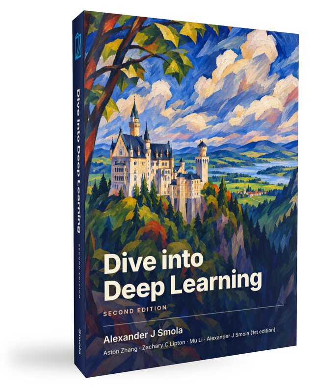
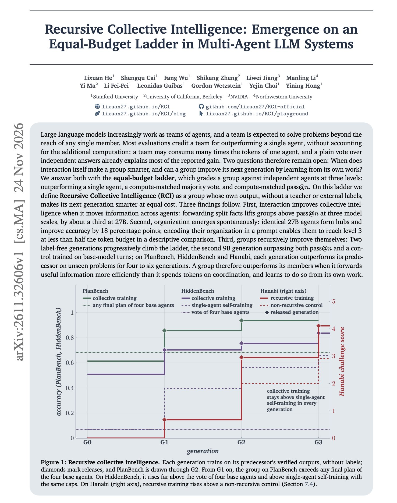

# 🐦 @dair_ai

## 📅 November 27, 2026

> 3 post(s) archived.

---

### 🕐 22:44 UTC · @dair_ai

> Drop everything and go read this. It&apos;s honestly one of the best practical deep learning books out there. This is the second edition. It covers the basic and advanced topics, LLMs, and the math behind deep learning.

🔗 [View original post](https://x.com/omarsar0/status/2126447006537400471)

---

### 🕐 16:15 UTC · @dair_ai

> I continue to be amazed by how well agent teams work. In other words, it&apos;s the idea of having a chief of staff, chief research officer, and other important agent roles. It has allowed me to scale work with agents, and it has also helped keep tasks organized as it scales. Roles, identities, and specialization will remain important primitives as we unlock collective intelligence in agents and scale with agent swarms. To be clear, I don&apos;t use any of the popular tools for this, like Grok Bot, Hermes, or personal agents. I have built my own solution, like with everything else. But I have been surprised by how great this all works, even though it&apos;s a simple implementation. Memory is key to making it all work because you need to persist important knowledge and preferences. Clearly define the agents&apos; roles in the team. Set up clear permissions as well. But you also need good solutions for coordination and automation. Use a minimal solution to ingest and track events and schedules. Let me know if you have any questions. I am happy to share more details on any of these.

🔗 [View original post](https://x.com/omarsar0/status/2126349232818753661)

---

### 🕐 15:19 UTC · @dair_ai

> Must-read paper on recursive collective intelligence. Highly recommend if you are planning to use agent swarms. They find that an agent team beats AIs working alone only when each one knows something the others don&apos;t and shares it. This aligns with my suspicion that collective intelligence comes from pooling different knowledge. Adding more AIs that all know the same things doesn&apos;t make the group smarter. This is particularly important if you are trying to build agent swarms. This work specifically asks if agent teams can improve recursively at the same compute budget. They check whether that gain comes from teamwork or from extra compute. A team uses many more tokens than one agent. Running several agents on their own with the same token budget and taking a majority vote already explains most of the gain. So the authors test each team against three bars, all at the same compute. The team has to beat one agent. Then it has to beat a majority vote of independent agents. The hardest bar is a group of independent agents where a task counts as solved if any one of them gets it right. Teamwork cleared the hardest bar only when each agent held different facts and passed them on to the others. In that setup, teams beat the hardest bar at three model sizes, by about a third with 27B models. Teams of identical 27B agents also organized themselves without being told to. A few agents became hubs that collected and shared information, and accuracy rose 18 points. Groups then trained their next generation on their own verified outputs, with no labels. On PlanBench, HiddenBench, and Hanabi, each generation beat the previous one on unseen problems for four to six generations. https://arxiv.org/abs/2611.32606 Chat with Paper: https://academy.dair.ai/papers/recursive-collective-intelligence-emergence-on-an-equal-budget-ladder-in-multi-a-2611.32606

🔗 [View original post](https://x.com/omarsar0/status/2126334991768711575)

---
