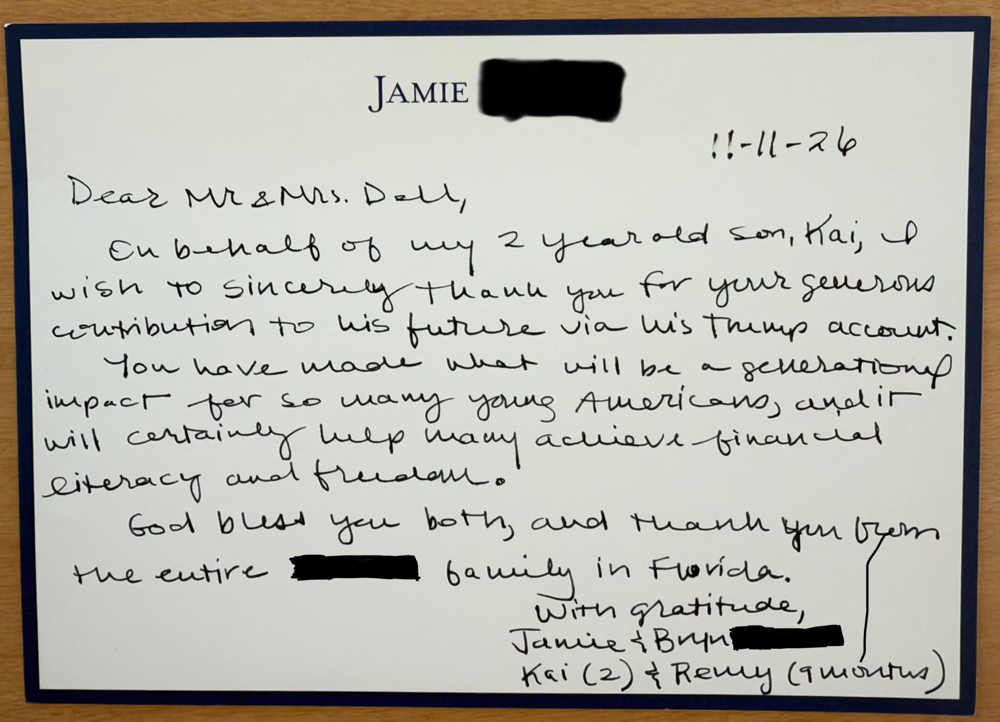

# 🐦 @elonmusk

## 📅 November 27, 2026

> 17 post(s) archived.

---

### 🕐 19:00 UTC · @elonmusk

> Grok Build upgrades Grok Build just got a solid upgrade for headless agents, MCP integrations, and remote terminal workflows Headless sessions can now include images returned by MCP tools in streaming and JSON output, positional prompts automatically run headless when no interactive terminal is ava…

🔗 [View original post](https://x.com/elonmusk/status/2126390700660920546)

---

### 🕐 18:52 UTC · @elonmusk

> Accurate Gavin Baker says SpaceX engineers believe they have solved orbital compute and are actually stressed about Starship reusability “I think catching the Starship, that was amazing. It was a huge moment for SpaceX.” “I will just say having spent a lot of time at Starbase, the SpaceX…

🔗 [View original post](https://x.com/elonmusk/status/2126388828852105325)

---

### 🕐 18:52 UTC · @elonmusk

> Grok Bot is great at finding you the best deals on the Internet JUST IN: Shopify reveals Grok Bot and other agents are playing a &quot;real role&quot; this shopping season, and calls it the first agentic Black Friday Harley Finkelstein (President): &quot;The reason I mention that is those are very specific products. And I think one of the new things that&apos;s…

🔗 [View original post](https://x.com/elonmusk/status/2126388636325499201)

---

### 🕐 18:21 UTC · @elonmusk

> Must Listen to the end! @GavinNewsom rises above politics &amp; nails it. “I emphatically encourage people to claim their Trump Account… don’t fall prey to the political cynicism… this is your money. It is direct, tangible, results oriented, not lost in bureaucracy.” 🎯🇺🇸🚀 Media

🔗 [View original post](https://x.com/altcap/status/2126380906843979898)

---

### 🕐 18:03 UTC · @elonmusk

> My observation is that giving money to “non-profits” rarely benefits the people and often results in hurting civilization by creating a self-perpetuating “cause of the day” bureaucracy that cares only about getting more money. Such “charities” are often merely a means of a wealthy donor buying power over people and governments, while appearing to be a “philanthropist”. Much better to give directly to the people and let them decide what they want to do.

🔗 [View original post](https://x.com/elonmusk/status/2126376500584702103)

---

### 🕐 18:02 UTC · @elonmusk

> Tim Urban on @elonmusk: &quot;He&apos;s truly trying to do these big things for the right reasons.&quot; Media

🔗 [View original post](https://x.com/teslaownersSV/status/2126376230920626285)

---

### 🕐 17:21 UTC · @elonmusk

> Grok @Bot keeps getting better Gavin Baker says Grok Bot feels like another ChatGPT moment because it turns hours of Claude Code work into seconds: &quot;You see these 23-year-old kids and just the way they use AI, they&apos;re just fluent and native in it. I just feel like maybe in a way that no matter how hard I try,…

🔗 [View original post](https://x.com/elonmusk/status/2126365899410341931)

---

### 🕐 17:03 UTC · @elonmusk

> 15-year-olds in California are now forced to use a booster seat in a car unless they pass a test... but they can change their gender without parental consent. Make it make sense.

🔗 [View original post](https://x.com/libsoftiktok/status/2126361405217509537)

---

### 🕐 13:47 UTC · @elonmusk

> Our gift is about so much more than money. It’s about teaching an entire generation of young Americans the power of investing, compound interest and ownership. 🇺🇸🚀

🔗 [View original post](https://x.com/MichaelDell/status/2126311994995171813)

---

### 🕐 13:40 UTC · @elonmusk

> 15 year olds in California may to have to ride in a booster seat starting in January? We&apos;re now well into the territory of self-parody. This law should go.

🔗 [View original post](https://x.com/paulg/status/2126310099475956175)

---

### 🕐 09:59 UTC · @elonmusk

> &quot;If printing money would end poverty, printing diplomas would end stupidity.&quot; Javier Milei. This is France&apos;s problem in one sentence. We did with degrees what central banks do with money: we printed them until they were worth nothing. The master&apos;s degree has become a debased currency. And like all inflation, it leaves no visible victims. It quietly destroys the signal. The result: average people, holding some forgettable master&apos;s from a second-rate university, sincerely believe they belong to the elite. They have the title. They have the stamp. They expect the status that&apos;s supposed to come with it. And when reality refuses to hand it over, they conclude the system is unfair. But that&apos;s not even the real tragedy. The real tragedy is that when everyone has the same degree, the degree says nothing. Truly brilliant people become invisible, drowned in a sea of identical CVs. We built a machine that makes mediocrity comfortable and excellence undetectable. A country doesn&apos;t move forward because of how many graduates it produces. It moves forward because of a handful of exceptional people it knows how to spot, fund, and let build. France doesn&apos;t need more graduates. It needs more brilliant people, recognized as brilliant for what they built, not for the paper on their wall. Your degree says what you studied. What you built says who you are. Printing diplomas never created intelligence. Only inflation.

🔗 [View original post](https://x.com/brivael/status/2126254601028477111)

---

### 🕐 07:52 UTC · @elonmusk

> True I used to think Trump Accounts were only for newborns because of the $1,000 government contribution. So I never bothered to set one up for my kids. Out of my three children, two are already adults (over 18), so they aren’t eligible. But my youngest is still under 18, and yesterd…

🔗 [View original post](https://x.com/elonmusk/status/2126222666994737622)

---

### 🕐 05:15 UTC · @elonmusk

> Tom Mueller, SpaceX employee #1, says Elon Musk reversed his approach to engineering by demanding they find where rocket engines break and then push them harder &quot;It changed just working with Elon. At my previous company, it was like, you never blow up a rocket engine or fail a rocket engine. That&apos;s bad. This is bad karma. Never test, always have a lot of margin and make sure that you don&apos;t fail it.&quot; &quot;And Elon&apos;s whole thing was, well, let&apos;s find out where it breaks and then fix that and go and push it even more. So it&apos;s really a whole different way of thinking about it. Really refreshing, and you learn a lot.&quot; &quot;We had things that we thought would break that we couldn&apos;t break. Other things would break because the engineering is not always that deterministic. It&apos;s not always obvious. I&apos;m amazed that this thing is still running.&quot; Media Joe Rogan reveals he watched a SpaceX launch with Elon Musk from the command center, and says the rockets explode because SpaceX pushes them to the limit on purpose &quot;It&apos;s not just that. It just shows a complete lack of understanding of what he&apos;s trying to accomplish. The whole r…

🔗 [View original post](https://x.com/firesidealpha/status/2126183140083568686)

---

### 🕐 05:09 UTC · @elonmusk

> Working hard to make Blindsight happen. Happy Thanksgiving from the Neuralink team!

🔗 [View original post](https://x.com/djseo/status/2126181706118160696)

---

### 🕐 02:57 UTC · @elonmusk

> While white liberals in Boston officially recognize Thanksgiving as a “Day of Mourning,” I‘d like to take a moment to remember the Huron who were constantly displaced by the Iroquois. The Apache who were displaced, enslaved, tortured, raped and scalped by the Comanche. The Pueblo, who were often enslaved as part of a wider slave trade run by the Navajo nations. Maybe we can revisit the awful and inhumane wars between the Blackfoot and Cree nations? Perhaps we can make a statue to the inhumane treatment of captured Kiowa women and children at the hands of the Osage? Will we forget the long running and inhumane conflicts between the Lakota alliances against the Cheyenne? You see, American history is far more complex than your white liberal professors taught you. And all those atrocities didn’t end until the white man came and conquered this land and colonized the fuck out of it. YOU’RE WELCOME. 🇺🇸 P.s. But sorry about the blankets. That was our bad. &apos;National Day of Mourning&apos; in Plymouth, MA: &quot;And until this country...and all settler colonial projects are dismantled, we will continue to live in the time of the pilgrims...we cannot allow their crimes to be sanitized and forgotten. And that is why...we have gathered on this h…

🔗 [View original post](https://x.com/LuckyMcGee/status/2126148322838605889)

---

### 🕐 01:56 UTC · @elonmusk

> @cybertruck greatest robot out there

🔗 [View original post](https://x.com/jack/status/2126132989478519219)

---

### 🕐 00:26 UTC · @elonmusk

> Vital that children have a stake in the future Elon has announced that he will gift one @SpaceX share to each of the ~70 million children in America every year. At SpaceX’s current share price, that amounts to over $9 billion in gifts annually. If SpaceX’s stock price goes up, the value of those gifts/shares will be worth a …

🔗 [View original post](https://x.com/elonmusk/status/2126110344120762593)

---
