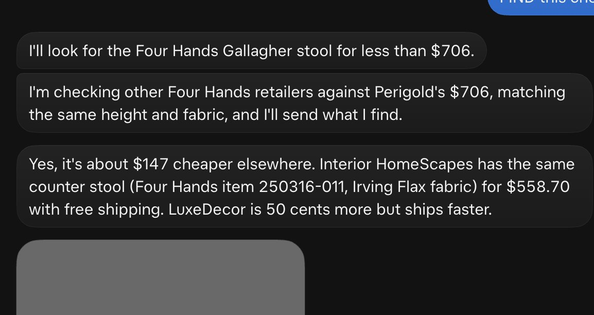
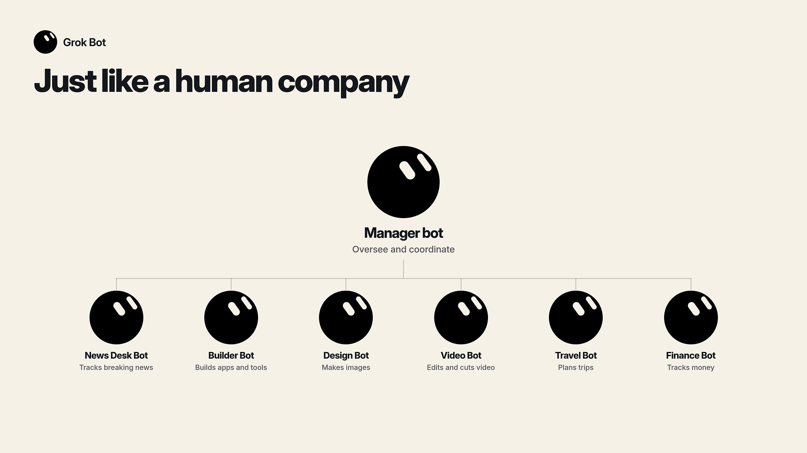
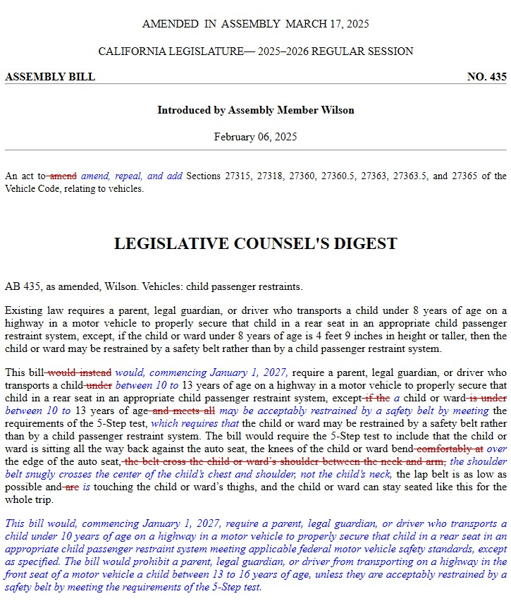
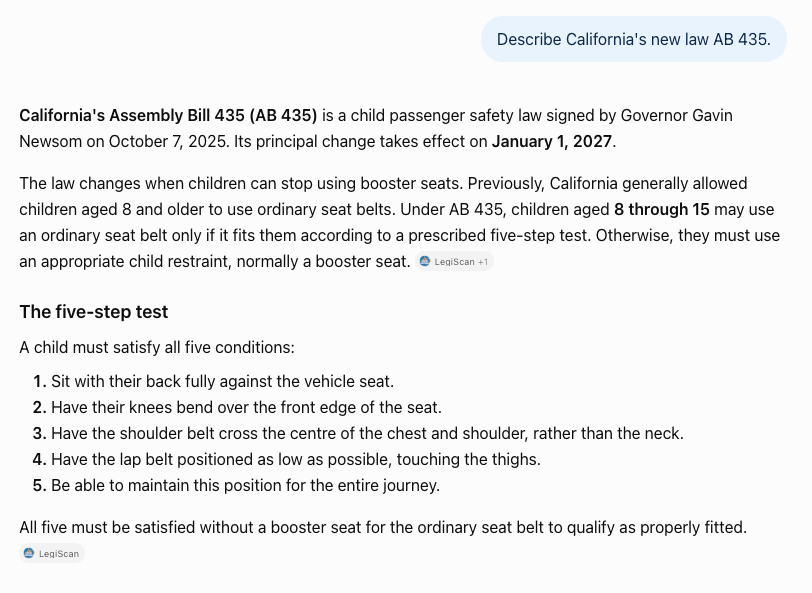
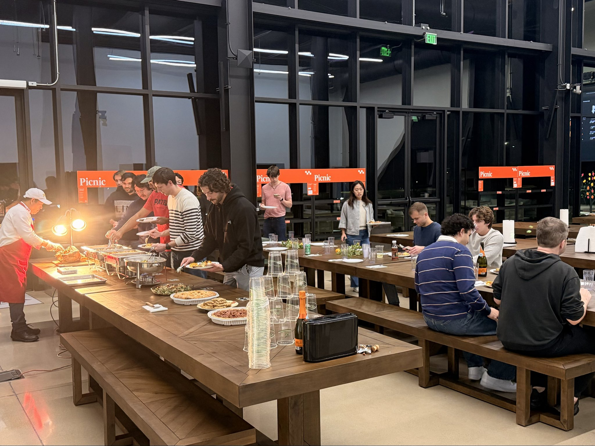

# 🐦 @elonmusk

## 📅 November 27, 2026

> 39 post(s) archived.

---

### 🕐 22:10 UTC · @elonmusk

> Give each Bot a specific job, just like people in a company Here&apos;s an example of how I manage my Grok Bots like a company. I currently have more than 30 bots.

🔗 [View original post](https://x.com/elonmusk/status/2126438463520350588)

---

### 🕐 22:08 UTC · @elonmusk

> This is the way Interestingly enough, I have one bot named “Grok”. It’s my “everything” bot. I noticed some ball dropping so I created more bots focusing on smaller tasks. Instantly noticed improvement. What’s important, however, are that the bots can still talk to each other. I ask “Are you fa…

🔗 [View original post](https://x.com/elonmusk/status/2126438150314631286)

---

### 🕐 22:08 UTC · @elonmusk

> Give Grok Bot your hardest problems My dad works at a steel fabrication company in Slovenia. Every order starts as a PDF of technical drawings, and someone has to type every dimension and part table into Excel to work out how much steel to buy. Estimators often spend about an hour per drawing sheet on that. This w…

🔗 [View original post](https://x.com/elonmusk/status/2126438008748384711)

---

### 🕐 21:49 UTC · @elonmusk

> I&apos;ve had Grok @Bot find the best Black Friday deals for me all day, and it&apos;s actually working really well. Already saved $445 on a few kitchen stools and $200 on a TV. Having useful agents is really going to change the way we shop.

🔗 [View original post](https://x.com/SawyerMerritt/status/2126433262801502577)

---

### 🕐 21:34 UTC · @elonmusk

> Elon Musk on how to get the most out of Grok Bots: organize them like a real company Create multiple Grok Bots with specialized roles, such as coding, data analysis, financial management, expense tracking, email management, travel planning and daily operations, with a manager bot overseeing and coordinating their work Just like a human employee, overloading a single bot with too many responsibilities leads to tasks being missed The same principles of specialization, delegation and management that make human companies efficient also apply to autonomous SI agents You’re essentially building your own digital workforce with Grok Bots When using Grok Bots, it is important to create Bots with specialized roles, just like a human company. You can then have a manager bot oversee and coordinate their work. Just like a human employee, if you overload a single bot with a massive array of work, it will start droppin…

🔗 [View original post](https://x.com/XFreeze/status/2126429392071262477)

---

### 🕐 21:34 UTC · @elonmusk

> Worth trying holy sh*t, let Grok Bot watch you work for one week, it will change your life... it finds everything that&apos;s wasting your time, then builds the bots that do it all for you. you can save hours every week, without changing a single thing about how you work. here&apos;s the prompt, paste…

🔗 [View original post](https://x.com/elonmusk/status/2126429365504229400)

---

### 🕐 21:29 UTC · @elonmusk

> The goal with Grok Bots is to enable you to build a whole company! This is the biggest differentiator between another consumer friendly bot like Muse. Grok Bot feels like a team. The other feels like a servant.

🔗 [View original post](https://x.com/elonmusk/status/2126428324012446090)

---

### 🕐 21:24 UTC · @elonmusk

> Major improvements land every week for Grok Bot Grok Bot is actually the first autonomous AI agent that I&apos;m still using after months. Other agents I tried in the past couldn&apos;t hold me as a user for more than a few weeks. Main things I use Grok Bot for: – tracking AI news for content ideas – tracking startups raising money so …

🔗 [View original post](https://x.com/elonmusk/status/2126426934431404067)

---

### 🕐 21:23 UTC · @elonmusk

> My dad works at a steel fabrication company in Slovenia. Every order starts as a PDF of technical drawings, and someone has to type every dimension and part table into Excel to work out how much steel to buy. Estimators often spend about an hour per drawing sheet on that. This week they set up @bot in about an hour. Now they drop in the PDF and the spreadsheet with all the calculations comes out.

🔗 [View original post](https://x.com/larsencc/status/2126426739391816118)

---

### 🕐 21:14 UTC · @elonmusk

> Tesla super vision Human driver: *fails to find road* FSD V15: lmao

🔗 [View original post](https://x.com/elonmusk/status/2126424460639313922)

---

### 🕐 21:13 UTC · @elonmusk

> Upgrades Grok Bot team shipped in the last few days: • Flights, hotels, and rental cars bookings in chat • 11% more usage out of each plan • Up to 50% more usage for routines • Google Ads and Google Analytics connectors • Smarter Slack Bots • QuickBooks connector

🔗 [View original post](https://x.com/elonmusk/status/2126424190475501877)

---

### 🕐 20:39 UTC · @elonmusk

> Yeah Elon Musk: &quot;I lived in the Fremont and Nevada factories for three years, fixing that production line, running around like a maniac through every part of that factory.&quot; &quot;Living with the team, I slept on the floor so that the team, who was going through a hard time, could see me o…

🔗 [View original post](https://x.com/elonmusk/status/2126415725548228614)

---

### 🕐 20:32 UTC · @elonmusk

> When using Grok Bots, it is important to create Bots with specialized roles, just like a human company. You can then have a manager bot oversee and coordinate their work. Just like a human employee, if you overload a single bot with a massive array of work, it will start dropping some of the balls.

🔗 [View original post](https://x.com/elonmusk/status/2126413886576590925)

---

### 🕐 20:32 UTC · @elonmusk

> 🚨 FSD v15 Reality View in heavy rain. Windshield completely blurred, yet the visualization stays sharp. Cars, lanes, road markings, everything crystal clear. This is what supervised autonomy looks like when weather turns bad. Europe has plenty of rainy days. Time to let more drivers use this. #FSD #Tesla https://x.com/TSLA_Bitcoin/status/2126229287481049332/video/1 Media

🔗 [View original post](https://x.com/Rustavi/status/2126413760021618949)

---

### 🕐 20:29 UTC · @elonmusk

> We can’t scale a negative gross margin business. That’s just impossible. Muse is a personal assistant, but doesn’t apply the level of heavy-hitter AI needed to operate a company at serious scale. If Grok Bots are providing high value on par with having excellent employees, then the monthly cost can be quite high, but still deliver outstanding RoI. However, if we do something dumb, like making it complicated to upgrade to higher usage tiers (a mistake we’ve made before), then we need to fix that.

🔗 [View original post](https://x.com/elonmusk/status/2126413161607692773)

---

### 🕐 20:16 UTC · @elonmusk

> I am very impressed with the Grok Bot intelligence for any task. I am advising the team, and they have really exciting features planned, like playbooks. Every model has its strengths and weaknesses. Grok @Bot aims to use whichever one does the best job for the task you give it! Neon is looking particularly promising, but Opus is also excellent in most cases.

🔗 [View original post](https://x.com/adeoressi/status/2126409945184870490)

---

### 🕐 20:03 UTC · @elonmusk

> By 2042 SpaceX will be operating the Starlink network, a million-satellite Starmind constellation comprising about 1/3 of global compute, will have sent manned expeditions to Mars, and will be supporting a manned base on the Moon and, quite possibly, Mars. There&apos;s every possibility of diversifying into asteroid mining, orbital refining and manufacturing, and orbital solar power. An orbital solar power array about the size of Montenegro, which could be built by disassembling a small asteroid, would double the planet&apos;s current electrical power budget. An array a mere 5x larger would double humanity&apos;s primary energy consumption. So yes, a $16T market cap is entirely plausible. This math sounds great until you realize that Space X stock compounding at 15% per year for the next 16 years means the market capitalization will be $16T Current US GDP is roughly $33 trillion, implying that Space X would be roughly half the size of the US economy today

🔗 [View original post](https://x.com/martianwyrdlord/status/2126406477392785477)

---

### 🕐 19:56 UTC · @elonmusk

> This will be fully automated and sped up to be &lt;5 mins 🚀 Starship stacking is an incredible sight. 🤩 A time-lapse captures Ship 42 being stacked onto Booster 22 at Starbase. The main lift reportedly takes just around 30 minutes, while the final alignment and precise docking process takes considerably longer. Imagine the engineerin…

🔗 [View original post](https://x.com/elonmusk/status/2126404709628129388)

---

### 🕐 19:30 UTC · @elonmusk

> Beautiful engineering Media

🔗 [View original post](https://x.com/elonmusk/status/2126398247552037042)

---

### 🕐 19:27 UTC · @elonmusk

> Every model has its strengths and weaknesses. Grok @Bot aims to use whichever one does the best job for the task you give it! Neon is looking particularly promising, but Opus is also excellent in most cases. I stopped using Claude about two weeks ago because it was becoming increasingly difficult/combative/manipulative to work with. Switched to Grok Bot as a test run for repeated tasks and had it scan my computers for regular file clean up. It found 22+ GBs of temp files, and bloat …

🔗 [View original post](https://x.com/elonmusk/status/2126397498071670827)

---

### 🕐 19:00 UTC · @elonmusk

> Grok Build upgrades Grok Build just got a solid upgrade for headless agents, MCP integrations, and remote terminal workflows Headless sessions can now include images returned by MCP tools in streaming and JSON output, positional prompts automatically run headless when no interactive terminal is ava…

🔗 [View original post](https://x.com/elonmusk/status/2126390700660920546)

---

### 🕐 18:52 UTC · @elonmusk

> Accurate Gavin Baker says SpaceX engineers believe they have solved orbital compute and are actually stressed about Starship reusability “I think catching the Starship, that was amazing. It was a huge moment for SpaceX.” “I will just say having spent a lot of time at Starbase, the SpaceX…

🔗 [View original post](https://x.com/elonmusk/status/2126388828852105325)

---

### 🕐 18:52 UTC · @elonmusk

> Grok Bot is great at finding you the best deals on the Internet JUST IN: Shopify reveals Grok Bot and other agents are playing a &quot;real role&quot; this shopping season, and calls it the first agentic Black Friday Harley Finkelstein (President): &quot;The reason I mention that is those are very specific products. And I think one of the new things that&apos;s…

🔗 [View original post](https://x.com/elonmusk/status/2126388636325499201)

---

### 🕐 18:21 UTC · @elonmusk

> Must Listen to the end! @GavinNewsom rises above politics &amp; nails it. “I emphatically encourage people to claim their Trump Account… don’t fall prey to the political cynicism… this is your money. It is direct, tangible, results oriented, not lost in bureaucracy.” 🎯🇺🇸🚀 Media

🔗 [View original post](https://x.com/altcap/status/2126380906843979898)

---

### 🕐 18:03 UTC · @elonmusk

> My observation is that giving money to “non-profits” rarely benefits the people and often results in hurting civilization by creating a self-perpetuating “cause of the day” bureaucracy that cares only about getting more money. Such “charities” are often merely a means of a wealthy donor buying power over people and governments, while appearing to be a “philanthropist”. Much better to give directly to the people and let them decide what they want to do.

🔗 [View original post](https://x.com/elonmusk/status/2126376500584702103)

---

### 🕐 18:02 UTC · @elonmusk

> Tim Urban on @elonmusk: &quot;He&apos;s truly trying to do these big things for the right reasons.&quot; Media

🔗 [View original post](https://x.com/teslaownersSV/status/2126376230920626285)

---

### 🕐 17:21 UTC · @elonmusk

> Grok @Bot keeps getting better Gavin Baker says Grok Bot feels like another ChatGPT moment because it turns hours of Claude Code work into seconds: &quot;You see these 23-year-old kids and just the way they use AI, they&apos;re just fluent and native in it. I just feel like maybe in a way that no matter how hard I try,…

🔗 [View original post](https://x.com/elonmusk/status/2126365899410341931)

---

### 🕐 17:03 UTC · @elonmusk

> 15-year-olds in California are now forced to use a booster seat in a car unless they pass a test... but they can change their gender without parental consent. Make it make sense.

🔗 [View original post](https://x.com/libsoftiktok/status/2126361405217509537)

---

### 🕐 16:28 UTC · @elonmusk

> Transparency builds trust. X Head of Safety @michaelo on open, verifiable safety decisions for brands from his recent Brand &amp; AI Safety Summit keynote. X’s @michaelo shares why platforms should make safety decisions transparent and verifiable for brands in @Adweek: https://adweek.com/social-marketing/show-your-work-platforms-must-make-safety-decisions-that-brands-can-verify

🔗 [View original post](https://x.com/XBusiness/status/2126352483454992883)

---

### 🕐 13:48 UTC · @elonmusk

> Another day of using @bot to its peak potential. Had my Chief look for Duos in stock and alert me when one was available nearby 🤌🏼

🔗 [View original post](https://x.com/aswincode/status/2126312123655430496)

---

### 🕐 13:47 UTC · @elonmusk

> Our gift is about so much more than money. It’s about teaching an entire generation of young Americans the power of investing, compound interest and ownership. 🇺🇸🚀

🔗 [View original post](https://x.com/MichaelDell/status/2126311994995171813)

---

### 🕐 13:40 UTC · @elonmusk

> 15 year olds in California may to have to ride in a booster seat starting in January? We&apos;re now well into the territory of self-parody. This law should go.

🔗 [View original post](https://x.com/paulg/status/2126310099475956175)

---

### 🕐 09:59 UTC · @elonmusk

> &quot;If printing money would end poverty, printing diplomas would end stupidity.&quot; Javier Milei. This is France&apos;s problem in one sentence. We did with degrees what central banks do with money: we printed them until they were worth nothing. The master&apos;s degree has become a debased currency. And like all inflation, it leaves no visible victims. It quietly destroys the signal. The result: average people, holding some forgettable master&apos;s from a second-rate university, sincerely believe they belong to the elite. They have the title. They have the stamp. They expect the status that&apos;s supposed to come with it. And when reality refuses to hand it over, they conclude the system is unfair. But that&apos;s not even the real tragedy. The real tragedy is that when everyone has the same degree, the degree says nothing. Truly brilliant people become invisible, drowned in a sea of identical CVs. We built a machine that makes mediocrity comfortable and excellence undetectable. A country doesn&apos;t move forward because of how many graduates it produces. It moves forward because of a handful of exceptional people it knows how to spot, fund, and let build. France doesn&apos;t need more graduates. It needs more brilliant people, recognized as brilliant for what they built, not for the paper on their wall. Your degree says what you studied. What you built says who you are. Printing diplomas never created intelligence. Only inflation.

🔗 [View original post](https://x.com/brivael/status/2126254601028477111)

---

### 🕐 07:52 UTC · @elonmusk

> True I used to think Trump Accounts were only for newborns because of the $1,000 government contribution. So I never bothered to set one up for my kids. Out of my three children, two are already adults (over 18), so they aren’t eligible. But my youngest is still under 18, and yesterd…

🔗 [View original post](https://x.com/elonmusk/status/2126222666994737622)

---

### 🕐 05:15 UTC · @elonmusk

> Tom Mueller, SpaceX employee #1, says Elon Musk reversed his approach to engineering by demanding they find where rocket engines break and then push them harder &quot;It changed just working with Elon. At my previous company, it was like, you never blow up a rocket engine or fail a rocket engine. That&apos;s bad. This is bad karma. Never test, always have a lot of margin and make sure that you don&apos;t fail it.&quot; &quot;And Elon&apos;s whole thing was, well, let&apos;s find out where it breaks and then fix that and go and push it even more. So it&apos;s really a whole different way of thinking about it. Really refreshing, and you learn a lot.&quot; &quot;We had things that we thought would break that we couldn&apos;t break. Other things would break because the engineering is not always that deterministic. It&apos;s not always obvious. I&apos;m amazed that this thing is still running.&quot; Media Joe Rogan reveals he watched a SpaceX launch with Elon Musk from the command center, and says the rockets explode because SpaceX pushes them to the limit on purpose &quot;It&apos;s not just that. It just shows a complete lack of understanding of what he&apos;s trying to accomplish. The whole r…

🔗 [View original post](https://x.com/firesidealpha/status/2126183140083568686)

---

### 🕐 05:09 UTC · @elonmusk

> Working hard to make Blindsight happen. Happy Thanksgiving from the Neuralink team!

🔗 [View original post](https://x.com/djseo/status/2126181706118160696)

---

### 🕐 02:57 UTC · @elonmusk

> While white liberals in Boston officially recognize Thanksgiving as a “Day of Mourning,” I‘d like to take a moment to remember the Huron who were constantly displaced by the Iroquois. The Apache who were displaced, enslaved, tortured, raped and scalped by the Comanche. The Pueblo, who were often enslaved as part of a wider slave trade run by the Navajo nations. Maybe we can revisit the awful and inhumane wars between the Blackfoot and Cree nations? Perhaps we can make a statue to the inhumane treatment of captured Kiowa women and children at the hands of the Osage? Will we forget the long running and inhumane conflicts between the Lakota alliances against the Cheyenne? You see, American history is far more complex than your white liberal professors taught you. And all those atrocities didn’t end until the white man came and conquered this land and colonized the fuck out of it. YOU’RE WELCOME. 🇺🇸 P.s. But sorry about the blankets. That was our bad. &apos;National Day of Mourning&apos; in Plymouth, MA: &quot;And until this country...and all settler colonial projects are dismantled, we will continue to live in the time of the pilgrims...we cannot allow their crimes to be sanitized and forgotten. And that is why...we have gathered on this h…

🔗 [View original post](https://x.com/LuckyMcGee/status/2126148322838605889)

---

### 🕐 01:56 UTC · @elonmusk

> @cybertruck greatest robot out there

🔗 [View original post](https://x.com/jack/status/2126132989478519219)

---

### 🕐 00:26 UTC · @elonmusk

> Vital that children have a stake in the future Elon has announced that he will gift one @SpaceX share to each of the ~70 million children in America every year. At SpaceX’s current share price, that amounts to over $9 billion in gifts annually. If SpaceX’s stock price goes up, the value of those gifts/shares will be worth a …

🔗 [View original post](https://x.com/elonmusk/status/2126110344120762593)

---
