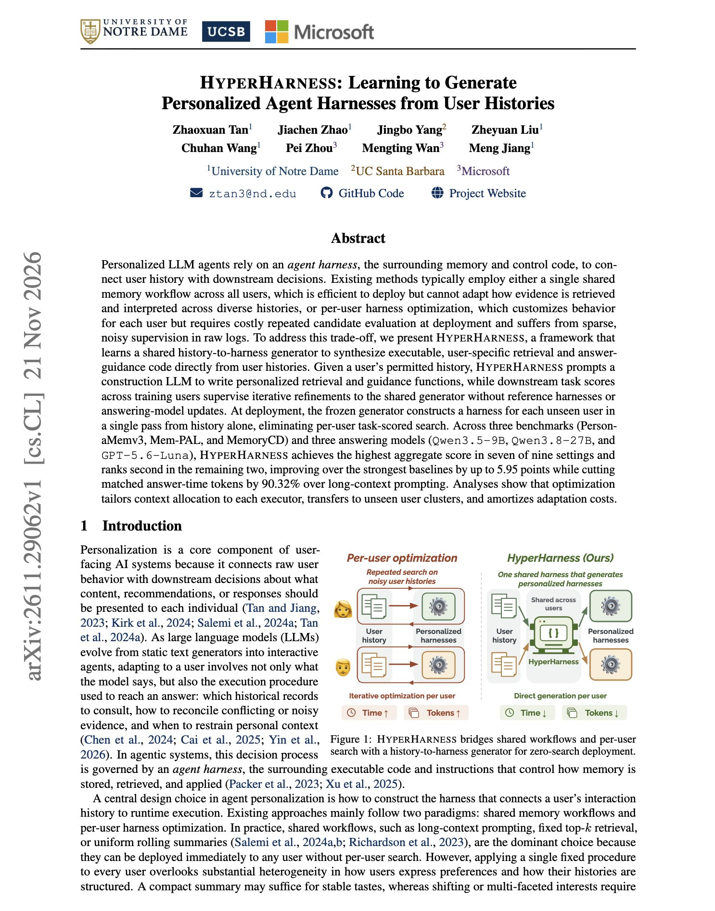

# 🐦 @omarsar0

## 📅 November 27, 2026

> 2 post(s) archived.

---

### 🕐 15:36 UTC · @omarsar0

> New paper from Microsoft and colleagues on personalized agent harnesses. If you build personalized assistants on top of user memory, this one is worth your time. The harness for a personalized agent is the memory and control code that connects a user&apos;s history to its answers. One shared workflow for all users is cheap but cannot adapt. Optimizing a separate harness per user adapts, but it needs a scored search for every user. HyperHarness trains one generator across many users. Given a user&apos;s history, a construction LLM writes retrieval and answer-guidance functions for that user. Task scores across training users refine the generator, and the answering model is never updated. At deployment, the frozen generator builds a harness for a new user in one pass. Across PersonaMemv3, Mem-PAL, and MemoryCD with three answering models, it had the best aggregate score in seven of nine settings and beat the strongest baselines by up to 5.95 points. It used 90.32% fewer answer-time tokens than long-context prompting. https://arxiv.org/abs/2611.29062 Chat with Paper: https://academy.dair.ai/papers/hyperharness-learning-to-generate-personalized-agent-harnesses-from-user-histori-2611.29062

🔗 [View original post](https://x.com/dair_ai/status/2126339269442818297)

---

### 🕐 12:02 UTC · @omarsar0

> Higgsfield Black Friday: less than 12 hours left for the Secret Plan. Our biggest offer of the year: &gt; Secret plan: 20,000 credits every month, 240,000 credits for the year, at $258/month (billed yearly) &gt; Get up to 75% OFF Higgsfield plans &gt; 3-day free trial for Higgsfield MCP Secret plan ends in less than 12 hours. Terms apply. Media

🔗 [View original post](https://x.com/higgsfield/status/2126285551838089375)

---
