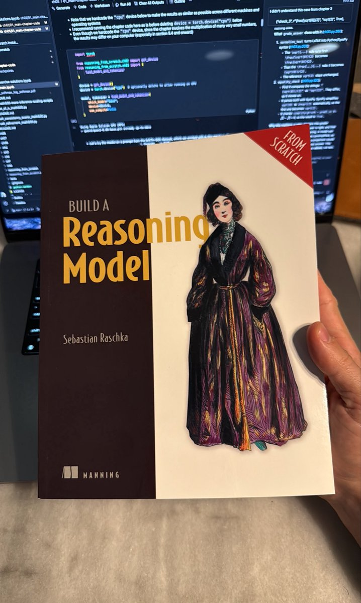

# 🐦 @rasbt

## 📅 November 27, 2026

> 1 post(s) archived.

---

### 🕐 14:56 UTC · @rasbt

> I really enjoyed reading this book by @rasbt. Great hands-on explanations of how reasoning models work, from inference time scaling to reinforcement learning and knowledge distillation. It helps connect the dots between the different approaches to reasoning.

🔗 [View original post](https://x.com/ysinjab/status/2126329349477392889)

---
