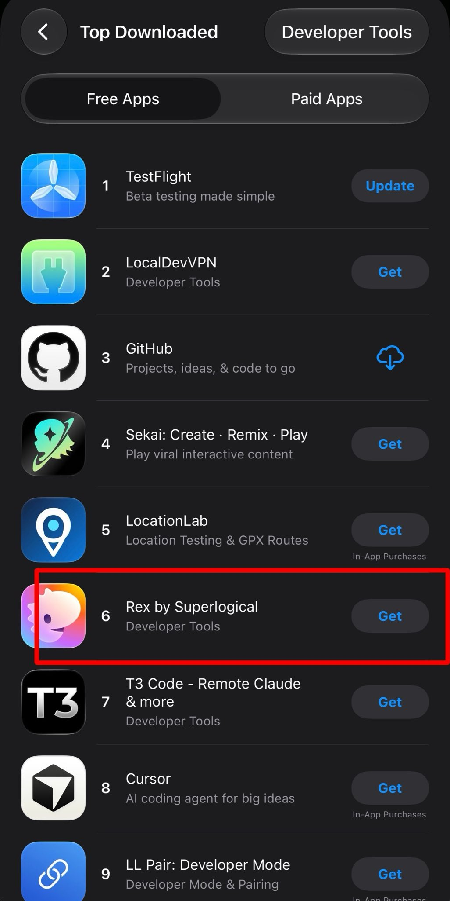

# 🐦 @swyx

## 📅 November 27, 2026

> 5 post(s) archived.

---

### 🕐 16:30 UTC · @swyx

> google has a new tibo, spawning just as neon is the hottest frontier model in the world. banked resets and all this is a completely revitalized GDM unlike which we have not seen since basically Gemini 2.5 in my memory. writeup coming @latentspacepod but basically the # of frontier and near-frontier labs has ~doubled every year since 2023 and that’s by far the biggest existence disproof that the bitter lesson is the sole determinant of ai industrial economics. @saranormous calls it model neurodiversity and basically its the single most impt macro factor driving the life/death of agent labs and ai engineering. wow, didn’t expect a hello world to hit 50k+ views and take me past 1k followers 🥹 to give thanks: i’m cooking up banked reset &amp; fixing papercuts 🧚🏻‍♀️ how can @antigravity be improved?

🔗 [View original post](https://x.com/swyx/status/2126352854394790172)

---

### 🕐 14:00 UTC · @swyx

> Your LLM might be overkill. @michellechen of @Cloudflare on the path from serving giant models to training small decision models, with a CI triage demo that uses fewer calls and tokens. Full Code Summit talk: https://youtu.be/cYcYfM9Mvwo

🔗 [View original post](https://x.com/aiDotEngineer/status/2126315113565097985)

---

### 🕐 06:29 UTC · @swyx

> beating cursor and t3code on day 0. strong start Rex is live in the App Store. It requires a Rex Server running on another device so maybe a hint that a full public release is imminent… in the meantime enjoy the startup animation and screenshots. 😎 https://apps.apple.com/us/app/rex-by-superlogical/id6813649254

🔗 [View original post](https://x.com/swyx/status/2126201671026180469)

---

### 🕐 02:02 UTC · @swyx

> no way

🔗 [View original post](https://x.com/zainhas/status/2126134487197340083)

---

### 🕐 00:09 UTC · @swyx

> i think agentic payments is one of the most divisive yet important themes to get right for 2028. no real in between, either you get in early or you declare its basically never gonna happen If you’re in agentic payments, pivot to: something useful.

🔗 [View original post](https://x.com/swyx/status/2126106139582677088)

---
