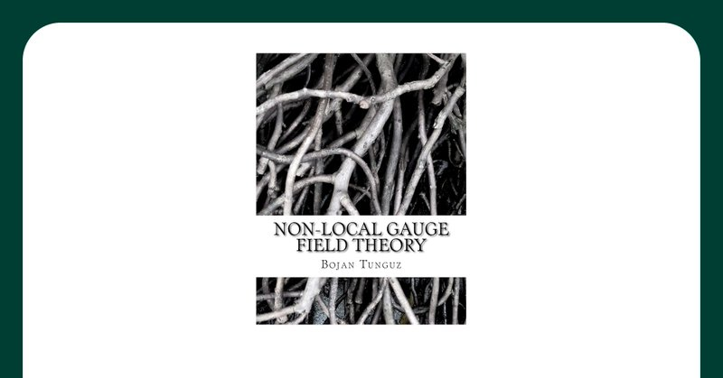

# 🐦 @tunguz

## 📅 November 27, 2026

> 11 post(s) archived.

---

### 🕐 19:07 UTC · @tunguz

> Ontology? In this AI economy?

🔗 [View original post](https://x.com/tunguz/status/2126392462000185374)

---

### 🕐 19:01 UTC · @tunguz

> You really thought that AI that’s powerful enough to figure out all of nature’s secrets can’t find out all of yours? LOL

🔗 [View original post](https://x.com/tunguz/status/2126391045319733611)

---

### 🕐 16:44 UTC · @tunguz

> Here is my quote from the blog post for the Future of Work Commission that I published a month ago: &quot;The most dramatic recent development has been in pure mathematics. This year, AI models began solving open problems that had stymied mathematicians for decades. In September, OpenAI published a proposed solution to the Navier–Stokes Millennium Prize problem, accompanied by a proof formalized in Lean. The Clay Mathematics Institute subsequently said the problem appeared to have been settled, while emphasizing its evaluation process. OpenAI released more than 700 mathematical manuscripts, with results at different stages of verification. The field is being rapidly upended, and how mathematicians adapt may show how other professions will adjust as AI overtakes their work.&quot; https://aiworkforcecommission.org/how-recent-ai-model-advances-are-reshaping-tech-jobs

🔗 [View original post](https://x.com/tunguz/status/2126356599795044808)

---

### 🕐 16:41 UTC · @tunguz

> This is a fair and honest perspective, and along the lines of something I&apos;ve been saying for months. Mathematicians are going through possibly the fastest automation event of any profession ever; certainly more than software engineers, which have automated incrementally from the start. Please give us a bit of grace while we absorb the shock, and brace yourselves for yours!

🔗 [View original post](https://x.com/tunguz/status/2126355830341545998)

---

### 🕐 16:18 UTC · @tunguz

> Here is the 10,000 ft big picture perspective on what I had set out to do. Most programs of unifying General Relativity (GR) with the Standard Model (SM) set out from the perspective that *geometry* is fundamental, GR is a theory of geometrodynamics, so let&apos;s try to make SM another gemetrodynamic theory. My thesis has been that SM is actually fundamental, that it&apos;s essentially a theory of transformations of *fields* which are object in a Hilbert space of functions, so how about we try to *field theorize* GR instead.

🔗 [View original post](https://x.com/tunguz/status/2126349947645620681)

---

### 🕐 15:47 UTC · @tunguz

> In other words, we have our &quot;spies&quot; in their datacenters, and they are *literally* begging us to *sell* them more of them. BREAKING: Nvidia&apos;s powerful Blackwell AI chips discovered at a Chinese data center linked to Alice Huang, despite U.S. export restrictions. — Bloomberg

🔗 [View original post](https://x.com/tunguz/status/2126342274691043487)

---

### 🕐 14:22 UTC · @tunguz

> In case you want to read more: https://a.co/d/0bH7cJeN

🔗 [View original post](https://x.com/tunguz/status/2126320692706832750)

---

### 🕐 12:07 UTC · @tunguz

> Hilbert space being ontologically prior to spacetime is *literally* the main insight behind my PhD thesis. If correct, OpenAI’s new tensor geometry results suggest that distance, Euclidean geometry and curvature constraints can emerge from algebraic information laws. This lends some mathematical support to the hypothesis that Hilbert space is ontologically prior to spacetime. https:/…

🔗 [View original post](https://x.com/tunguz/status/2126286817729360188)

---

### 🕐 02:29 UTC · @tunguz

> I haven&apos;t checked the length, but looks like 250,000 pages, give or take.

🔗 [View original post](https://x.com/tunguz/status/2126141389331447832)

---

### 🕐 02:23 UTC · @tunguz

> Wow! I just used ChatGPT to prove Pythagoras&apos; Theorem! 🤯🤯🤯 Here is the Lean proof: import Mathlib theorem pythagoras_rearrangement (a b c : ℝ) (h_area : (a + b)^2 = 4 * (a * b / 2) + c^2) : a^2 + b^2 = c^2 := by calc a^2 + b^2 = (a + b)^2 - 2 * a * b := by ring _ = 4 * (a * b / 2) + c^2 - 2 * a * b := by rw [h_area] _ = c^2 := by ring

🔗 [View original post](https://x.com/tunguz/status/2126139706383708213)

---

### 🕐 00:15 UTC · @tunguz

> At the end of those 12 months we’ll realize that NNs were the wrong choice. We are just beginning to master deep learning. Model architectures and optimizers are gonna be wild in the next 12 months.

🔗 [View original post](https://x.com/tunguz/status/2126107571513938186)

---
