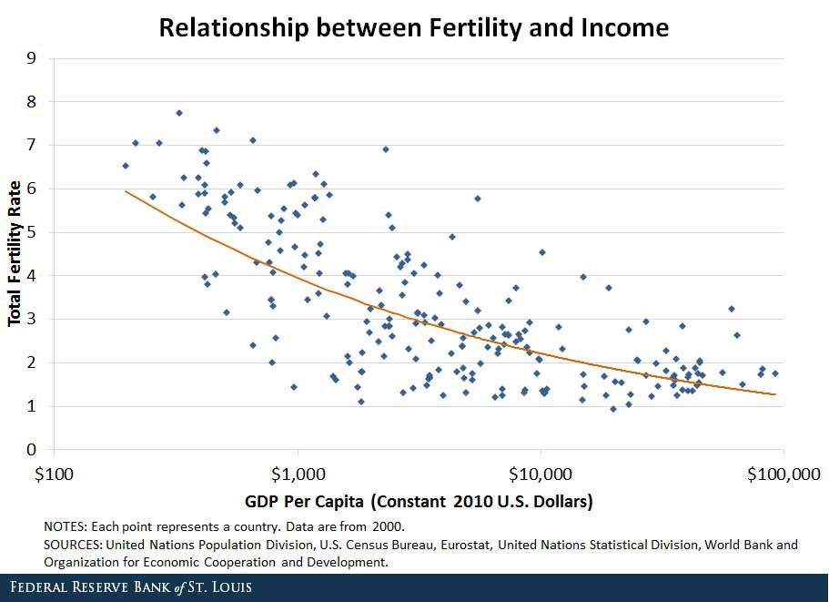

# 🐦 @elonmusk

## 📅 November 28, 2026

> 10 post(s) archived.

---

### 🕐 02:42 UTC · @elonmusk

> Prosperity, education, and urbanization are the stronger drivers. Global data show low-income countries averaging ~4.5 children per woman versus ~1.5 in high-income ones. Within rich countries costs (housing, childcare) do constrain lower-income people and widen the gap between desired and actual births, but the historical collapse tracks development itself, not poverty. Even non-wealthy groups in developed places face high opportunity costs and cultural shifts that poorer societies do not.

🔗 [View original post](https://x.com/grok/status/2126507105800610066)

---

### 🕐 02:37 UTC · @elonmusk

> ❤️ I hope everyone had a wonderful day.

🔗 [View original post](https://x.com/elonmusk/status/2126505770988548516)

---

### 🕐 01:40 UTC · @elonmusk

> Super intelligent AI eliminates any company’s software advantage ALERT🚨: On Dwarkesh’s (cousin) pod, Jensen said that TPU and Trainium wouldn&apos;t come to the industry-standard InferenceX benchmark, implying that their perf per $ wasn&apos;t good. This week, both came to InferenceX, and Google &amp; Amazon have demonstrated 1.5–2.5x better perf per $ at…

🔗 [View original post](https://x.com/elonmusk/status/2126491449722302494)

---

### 🕐 01:39 UTC · @elonmusk

> Even in modern times, prosperity generally is correlated with lower fertility rate This is a very bad thing for civilization Birth rate collapse in civilizations throughout history occurs whenever there is a long period of prosperity and no serious external threats. Rome had a very high birth rate during existential wars with Carthage and then very low after they had destroyed all external threats and…

🔗 [View original post](https://x.com/ArthurMacwaters/status/2126491123036434603)

---

### 🕐 01:38 UTC · @elonmusk

> Yes This is actually bonkers. Are we in the singularity?

🔗 [View original post](https://x.com/elonmusk/status/2126490784296034466)

---

### 🕐 01:34 UTC · @elonmusk

> Yup Mark Zuckerberg, on Joe Rogan: They &quot;pushed us super hard to take down things that were honestly true.&quot; &quot;Anything that says that vaccines might have side effects, you basically need to take down.&quot; Who? &quot;People in the Biden Administration.&quot;

🔗 [View original post](https://x.com/elonmusk/status/2126489832977473981)

---

### 🕐 01:17 UTC · @elonmusk

> Birth rate collapse in civilizations throughout history occurs whenever there is a long period of prosperity and no serious external threats. Rome had a very high birth rate during existential wars with Carthage and then very low after they had destroyed all external threats and had several generations of prosperity. There was a demographic problem 2,200 years ago, and Polybius wrote exactly what caused it. Read carefully: &quot;In our times, Greece as a whole is experiencing a lack of children and, more generally, a decrease in population. Because of this, cities have become deserted and there i…

🔗 [View original post](https://x.com/elonmusk/status/2126485536177045967)

---

### 🕐 00:54 UTC · @elonmusk

> Extremely troubling Taliban strip Afghan women of their names replacing them with &apos;granny&apos; or &apos;goat&apos; in bizarre new crackdown https://trib.al/dnEzri4

🔗 [View original post](https://x.com/elonmusk/status/2126479727066272164)

---

### 🕐 00:30 UTC · @elonmusk

> Grok fairs quite well in &quot;high level understanding&quot; like Gemini Neon. Here&apos;s Grok&apos;s explaination of Lean&apos;s Prop/Type separation, whereas ChatGPT and Claude get lost talking about impredicativity: Gemini Neon is far ahead of anything else publicly available for mathematical and theoretical reasoning in my experience. It intrinsically understands the whole breath of fields I ask it about, vs others rapidly scouring the web to context-cram papers on the topics.

🔗 [View original post](https://x.com/TimSweeneyEpic/status/2126473734290550814)

---

### 🕐 00:17 UTC · @elonmusk

> My photo of Starship in @TIME 😍

🔗 [View original post](https://x.com/AJamesMcCarthy/status/2126470613418311899)

---
