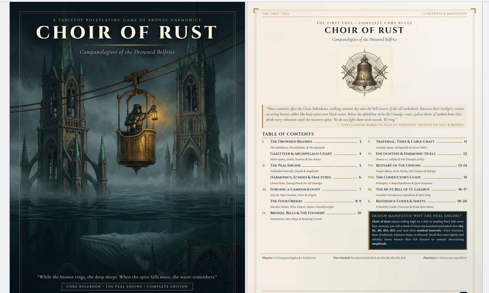

# 🐦 @emollick

## 📅 November 28, 2026

> 4 post(s) archived.

---

### 🕐 06:29 UTC · @emollick

> A note on demos: AI models are impressive when talking about AI. Ask them to make a music video or a slide deck or an explainer about AI/&quot;themselves&quot; and they will deliver you something creative &amp; unnerving But ask for the same for a non-AI topic and you can see more rough edges

🔗 [View original post](https://x.com/emollick/status/2126564206702899646)

---

### 🕐 03:12 UTC · @emollick

> Outside of whatever is happening in cryptography, I suspect we are going to see more cases where AI progress in seemingly abstract fields has implications for vital technologies that most people did not realize are related.

🔗 [View original post](https://x.com/emollick/status/2126514496781025710)

---

### 🕐 01:02 UTC · @emollick

> Gemini 4 Neon one-shots a novel RPG rulebook that is nicely laid-out and illustrated, and with a unique game mechanic... ...but it is about drowned bell towers and echoes and an ancient cataclysm and strange music. Just like most other RPG ideas from most other models. Odd.

🔗 [View original post](https://x.com/emollick/status/2126481900277755941)

---

### 🕐 00:48 UTC · @emollick

> As people pointed out in the comments, Gemini does this!

🔗 [View original post](https://x.com/emollick/status/2126478403876590008)

---
