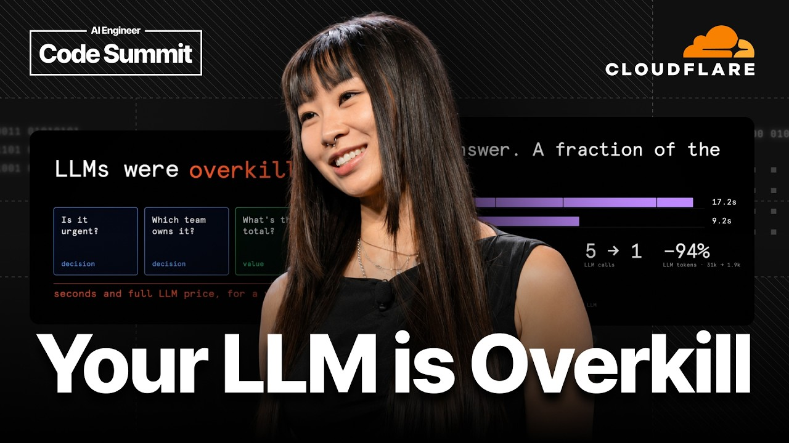
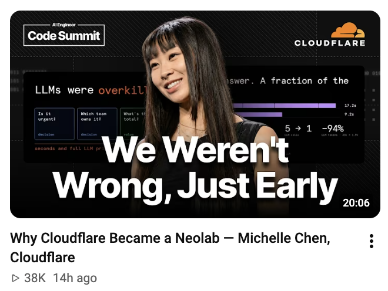

# 🐦 @swyx

## 📅 November 28, 2026

> 4 post(s) archived.

---

### 🕐 04:09 UTC · @swyx

> @michellechen https://www.youtube.com/watch?v=cYcYfM9Mvwo

🔗 [View original post](https://x.com/swyx/status/2126528949073453544)

---

### 🕐 04:09 UTC · @swyx

> worthwhile talk on whats going on with the neolab reinventions Feels like the most straightforward way these days get an offer from Anthropic or OpenAI is “work at Cloudflare” (which itself is hard enough to do fwiw)

🔗 [View original post](https://x.com/swyx/status/2126528882262348003)

---

### 🕐 03:43 UTC · @swyx

> https://x.com/aiDotEngineer/status/2125008996583018609?a=iVvAynKQtQR3kgfnYDc&amp;s=20 1M views for “Let&apos;s Open Source the World.” @echelon of @get_artcraft on building open source creative tools with Rust and coding agents, then his plan for a software factory to keep going. Welcome to the club, Brandon. https://youtu.be/UCL4K36SHp0

🔗 [View original post](https://x.com/swyx/status/2126522235334832346)

---

### 🕐 03:42 UTC · @swyx

> https://x.com/aiDotEngineer/status/2125001456105517122?a=4b_E2FMpv4doYnMNB00&amp;s=20 1M views. Time to rethink your Claude Code setup. @lydiahallie of @AnthropicAI on what to remove from CLAUDE.md, what permissions should enforce, and how agents can verify their work. Welcome to the club, Lydia. https://youtu.be/vlfCjWuv4es

🔗 [View original post](https://x.com/swyx/status/2126522209619624047)

---
